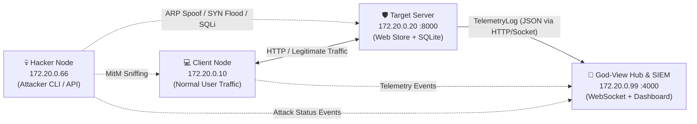

# 🛡️ PBL4 - Hệ Thống Mô Phỏng & Giám Sát Tấn Công Mạng (God-View)
> **Cyber Attack Simulation & Real-time Monitoring System**  
> Đồ án môn học: PBL4 (Chuyên ngành An toàn Thông tin / Mạng máy tính & Hệ điều hành)

---

## 📖 1. Giới thiệu tổng quan (Overview)

**PBL4 God-View** là hệ thống phòng thí nghiệm thực nghiệm mạng (Cyber Range / Lab Simulator) cho phép mô phỏng, phân tích và trực quan hóa các kịch bản tấn công mạng đa tầng (**L2 / L4 / L7 / Hệ điều hành**) theo thời gian thực dưới góc nhìn toàn cảnh (**God-View SIEM**).

Hệ thống cung cấp:
- **Mô phỏng đòn đánh thực tế:** ARP Spoofing (MitM), TCP SYN Flood DoS, TCP RST Injection, SQL Injection (SQLi), L7 Heavy Endpoint DoS.
- **Giám sát trạng thái nhân HĐH (Kernel Telemetry):** Theo dõi bảng ARP cache (`/proc/net/arp`), các trạng thái socket TCP (`SYN_RECV`, `ESTABLISHED`, `TIME_WAIT`), tải CPU/RAM của máy chủ.
- **Mô hình Phòng thủ Chiều sâu (Defense-in-Depth):** Hệ thống "3 Lớp Khiên Chắn" độc lập cho phép bật/tắt đối sánh trực quan hiệu quả ngăn chặn đòn tấn công trước và sau khi kích hoạt phòng thủ.

---

## 🌐 2. Kiến trúc mạng Docker (Network Topology)

Toàn bộ hệ thống chạy trên một dải mạng Docker Bridge cô lập (`cybersec-net`) với dải IP tĩnh `172.20.0.0/24`:



### Bảng phân định Node trong hệ thống:

| Node | Địa chỉ IP tĩnh | Cổng dịch vụ | Vai trò & Trách nhiệm chính |
| :--- | :--- | :--- | :--- |
| **Client** | `172.20.0.10` | N/A | Đại diện người dùng hợp lệ: gửi request duyệt sản phẩm, đăng nhập, đo ping, tải file. |
| **Target Server** | `172.20.0.20` | `8000` | Máy chủ mục tiêu: chạy Web Storefront, Database SQLite, chứa các điểm cắm lỗ hổng L7 và bộ thu thập Telemetry. |
| **Hacker** | `172.20.0.66` | `9000` | Máy kẻ tấn công: chứa công cụ Scapy, hping3, arpspoof, script khai thác SQLi / DoS. |
| **God-View** | `172.20.0.99` | `4000` | Trung tâm giám sát SIEM: tiếp nhận TelemetryLog vào Ring Buffer (300 items), phát WebSocket và trực quan hóa đồ họa Cyberpunk. |

---

## 🛡️ 3. Cơ chế Phòng thủ Chiều sâu (Defense-in-Depth)

Hệ thống minh chứng tính cấp thiết của việc áp dụng an ninh nhiều lớp:

```text
[Internet / Attacker]
       │
       ▼
┌────────────────────────────────────────────────────────┐
│  LỚP 1: TẦNG MẠNG (Network Layer Defense)              │
│  • Bảng ARP tĩnh (Static ARP Table chống ARP Poisoning) │
│  • Tường lửa iptables / DROP gói tin SYN bất thường    │
└──────────────────────────┬─────────────────────────────┘
                           │
                           ▼
┌────────────────────────────────────────────────────────┐
│  LỚP 2: TẦNG HỆ ĐIỀU HÀNH & KERNEL (OS Layer Defense)  │
│  • Bật SYN Cookies nhân Linux (tcp_syncookies = 1)     │
│  • Giới hạn tài nguyên cgroups & ulimit tiến trình     │
│  • Khóa shell thực thi (nologin)                       │
└──────────────────────────┬─────────────────────────────┘
                           │
                           ▼
┌────────────────────────────────────────────────────────┐
│  LỚP 3: TẦNG ỨNG DỤNG (Application Layer Defense)      │
│  • Parameterized Queries & Input Sanitization (Chặn SQLi)│
│  • Middleware API Rate Limiting theo IP & User         │
│  • Xác thực phân quyền Token JWT Bearer                │
└────────────────────────────────────────────────────────┘
```

---

## 📁 4. Cấu trúc thư mục mã nguồn (Project Structure)

```text
cybersec-pbl4/
├── docker-compose.yml              # Điều phối 4 container trong subnet 172.20.0.0/24
├── .env.example                    # Biến môi trường mẫu quy định IP, cổng, cờ phòng thủ
├── CONTRIBUTING.md                 # Quy tắc phân nhánh Gitflow và quy chuẩn commit
├── README.md                       # Tài liệu hướng dẫn này
│
├── shared/                         # Quy chuẩn và thư viện dùng chung giữa các Node
│   ├── schemas/                    # TypeScript Schema & Type Guards chuẩn hóa dữ liệu
│   │   ├── target-app.ts           # Interface User, LoginRequest/Response, ResourceItem
│   │   ├── telemetry.ts            # Interface TelemetryLog, PayloadSummary, AttackType
│   │   └── index.ts                # Barrel export tập trung
│   └── pcap/                       # File bắt gói tin mẫu (.pcap) phân tích Wireshark
│
├── target-system/                  # [Node Target Server & Client - 172.20.0.20]
│   └── app/                        # Ứng dụng Web Storefront & REST API (:8000)
│       ├── public/                 # Giao diện Web Bán Hàng DevSec Shop (HTML5 + Tailwind)
│       ├── src/
│       │   ├── config/env.ts       # Nạp cấu hình type-safe từ .env
│       │   ├── db/                 # Quản lý SQLite (node:sqlite) & Seed dữ liệu mẫu
│       │   ├── middleware/         # JWT Auth, Error Handler, Telemetry Interceptor
│       │   ├── routes/             # Auth, Resources, Simulation (Ping/Download/Heavy), Defense
│       │   ├── app.ts              # Express Server & Express Static setup
│       │   ├── server.ts           # Entrypoint HTTP Server cổng 8000
│       │   └── verify-endpoints.ts # Bộ test tự động 9 kịch bản API
│       ├── package.json
│       └── tsconfig.json
│
├── god-view/                       # [Node God-View SIEM - 172.20.0.99]
│   ├── backend/                    # Ingestion Hub & WebSocket Server (:4000)
│   │   ├── src/
│   │   │   ├── config.ts           # Cấu hình cổng 4000, Target App proxy
│   │   │   ├── ring-buffer.ts      # Ring Buffer FIFO 300 bản tin trong RAM
│   │   │   ├── server.ts           # REST API & Socket.io Server
│   │   │   └── verify-hub.ts       # Test tự động luồng tiếp nhận Telemetry
│   │   ├── package.json
│   │   └── tsconfig.json
│   └── frontend/                   # Dashboard Cyberpunk (HTML5 + Canvas 2D)
│       ├── index.html              # Sơ đồ Topology, Bảng điều khiển, Terminal Logs
│       ├── style.css               # Theme Cyberpunk Dark (#0a0e17, Neon Cyan & Red)
│       └── app.js                  # Particle Physics Engine, va đập khiên chắn, Socket.io
│
├── attacker/                       # [Node Hacker - 172.20.0.66]
│   ├── scripts/                    # Scripts tấn công Scapy, hping3, arpspoof
│   └── src/                        # Module hóa CLI/API kích hoạt tấn công từ xa
│
├── docs/                           # Tài liệu kỹ thuật chi tiết
│   ├── architecture/               # Thông số kỹ thuật kiến trúc hệ thống
│   ├── api/                        # Đặc tả REST & WebSocket API các node
│   ├── attacks/                    # Kịch bản tấn công L2/L4/L7 chi tiết
│   ├── defense/                    # Hướng dẫn cấu hình 3 lớp phòng thủ
│   └── runbooks/                   # Kịch bản thực nghiệm demo cho hội đồng chấm
│
└── scripts/                        # Scripts tự động hóa thiết lập môi trường & reset lab
```

---

## 🚀 5. Hướng dẫn cài đặt & Khởi chạy nhanh (Quick Start)

### Yêu cầu hệ thống:
- **Node.js:** Phiên bản `>= 18.0.0` (Khuyến nghị Node.js 20 hoặc 22/24).
- **Git:** Đã cấu hình trên máy.
- **Docker & Docker Compose:** *(Tùy chọn khi chạy môi trường 4 container tách biệt)*.

---

### Bước 1: Khởi động God-View SIEM Monitor (Cổng 4000)

Mở cửa sổ Terminal thứ nhất:

```powershell
# Di chuyển vào thư mục God-View Backend
cd god-view/backend

# Cài đặt dependencies (Express, Socket.io, TypeScript)
npm install

# Khởi chạy máy chủ Ingestion Hub & Dashboard
npm start
```

🌐 **Truy cập Giao diện God-View:** Mở trình duyệt tại [http://localhost:4000](http://localhost:4000)

---

### Bước 2: Khởi động Target Web App (Cổng 8000)

Mở cửa sổ Terminal thứ hai:

```powershell
# Di chuyển vào thư mục Target App
cd target-system/app

# Cài đặt dependencies (Express, JWT, SQLite)
npm install

# Khởi chạy server Target App ở chế độ dev (watch mode)
npm run dev
```

🛒 **Truy cập Giao diện Bán Hàng (DevSec Shop):** Mở trình duyệt tại [http://localhost:8000](http://localhost:8000)

---

### Bước 3: Chạy Kiểm thử Tự động (Automated Verification)

Tại thư mục `target-system/app`, chạy lệnh sau để kiểm tra toàn bộ 9 kịch bản API:

```powershell
npm test
```

**Kết quả kiểm thử đạt chuẩn 100%:**
- `GET  /api/health` $\rightarrow$ 200 OK (Kiểm tra trạng thái máy chủ & cờ khiên L3).
- `POST /api/login` (Tài khoản chuẩn `admin`) $\rightarrow$ 200 OK (Cấp Access Token JWT).
- `POST /api/login` (Bypass SQLi `admin' --`) $\rightarrow$ 200 OK (Cảnh báo `SQL_INJECTION`).
- `GET  /api/resources` (Không có Token) $\rightarrow$ 401 UNAUTHORIZED.
- `GET  /api/resources` (Có Bearer Token) $\rightarrow$ 200 OK (Truy xuất danh mục tài nguyên mật).
- `GET  /api/ping` $\rightarrow$ 200 OK (Đo độ trễ RTT latency).
- `GET  /api/download` $\rightarrow$ 200 OK (Stream chunk 64KB tải file 1MB an toàn RAM).
- `GET  /api/heavy-load` $\rightarrow$ 200 OK (Thử nghiệm tính toán nặng CPU SHA-256).
- `POST /api/heavy` $\rightarrow$ 200 OK (Thử nghiệm tải nặng qua POST DoS).

---

## 📡 6. Danh mục API Endpoints

### Target Web App (`http://localhost:8000`):

| Endpoint | Method | Header xác thực | Mô tả chức năng |
| :--- | :---: | :---: | :--- |
| `/` | `GET` | Không | Giao diện Web Bán Hàng DevSec Shop (Storefront HTML/Tailwind). |
| `/api/login` | `POST` | Không | Đăng nhập hệ thống (cho phép khai thác SQLi khi khiên L3 tắt). |
| `/api/resources` | `GET` | `Bearer <token>` | Lấy danh sách tài nguyên mật (Confidential / Internal / Products). |
| `/api/resources/:id` | `GET` | `Bearer <token>` | Lấy thông tin chi tiết một tài nguyên mật cụ thể. |
| `/api/ping` | `GET` | Không | Đo độ trễ mạng RTT (`?t=<timestamp>&echo=<msg>`). |
| `/api/download` | `GET` | Không | Tải file nhị phân giả lập đo lưu lượng băng thông (`?size=1mb`). |
| `/api/heavy-load` | `GET` | Không | Mô phỏng DoS L7 tiêu tốn CPU & tạo trễ (`?iterations=150000`). |
| `/api/heavy` | `POST` | Không | Mô phỏng DoS L7 qua phương thức POST body JSON. |
| `/api/health` | `GET` | Không | Kiểm tra trạng thái máy chủ và cờ phòng thủ L3. |
| `/api/defense/status` | `GET` | Không | Xem trạng thái khiên chắn tầng ứng dụng L3. |
| `/api/defense/toggle` | `POST` | Không | Bật/tắt nhanh khiên chắn phòng thủ L3 (Anti-SQLi / Anti-DoS). |

### God-View SIEM Hub (`http://localhost:4000`):

| Endpoint | Method | Mô tả chức năng |
| :--- | :---: | :--- |
| `/` | `GET` | Giao diện Cyberpunk Dashboard (Topology Canvas 2D + Terminal Log Table). |
| `/api/telemetry` | `POST` | Nhận bản tin `TelemetryLog`, lưu Ring Buffer và phát qua WebSocket `GOD_VIEW_UPDATE`. |
| `/api/telemetry/history`| `GET` | Trả về danh sách bản tin trong bộ đệm khi giao diện tải lại (F5). |
| `/api/telemetry/clear` | `DELETE`| Xóa rỗng toàn bộ Ring Buffer trong RAM. |
| `/api/defense/toggle` | `POST` | Chuyển tiếp lệnh bật/tắt khiên phòng thủ sang Target App. |
| `/api/health` | `GET` | Trạng thái Hub, số lượng client WebSocket đang kết nối. |

---

## 🔑 7. Tài khoản mẫu dùng trong Thực nghiệm (Seed Data)

| Username | Password | Vai trò (Role) | Mục đích thử nghiệm |
| :--- | :--- | :---: | :--- |
| `admin` | `adminPassword2026!` | `admin` | Quản trị viên cấp cao: toàn quyền xem tất cả tài nguyên mật. |
| `alice` | `aliceSecretPassword` | `user` | Người dùng thông thường: xem tài nguyên nội bộ. |
| `victim`| `victimPassword123` | `user` | Tài khoản nạn nhân giả lập trong kịch bản Brute-force / Phishing. |
| `guest` | `guestPassword` | `guest` | Khách vãng lai quan sát hệ thống. |
| `admin' --` | *(Mật khẩu bất kỳ)* | `admin` | **Chuỗi tấn công SQL Injection:** Vượt qua xác thực khi khiên L3 TẮT. |

---

## 🤝 8. Quy chuẩn Đóng góp & Quy trình Git (Gitflow)

Dự án áp dụng mô hình **Gitflow cải tiến**, sử dụng quy ước **Conventional Commits** và chiến lược **Squash and Merge** khi gộp tính năng vào nhánh `develop`:

- `feature/*`: Phát triển tính năng mới (ví dụ: `feature/t1-target-app-api`, `feature/t3-god-view-hub`).
- `fix/*`: Sửa lỗi phát sinh trên `develop`.
- `docs/*`: Cập nhật tài liệu, slide thuyết trình, báo cáo.

Chi tiết quy chuẩn phân nhánh, cách đặt tên commit và mở Pull Request được quy định tại [CONTRIBUTING.md](CONTRIBUTING.md).

---

## 👥 9. Nhóm tác giả thực hiện

* **Trung (TV1):** Phụ trách Kiến trúc hệ thống, Target Web App & Telemetry Agent.
* **Trí (TV2):** Phụ trách Kịch bản tấn công (L2/L4/L7), PCAP Analysis & Hacker Module.
* **Nguyên (TV3):** Phụ trách Trạm giám sát God-View SIEM, WebSocket Ingestion & Dashboard.

---

*Trường Đại học Bách Khoa - Đại học Đà Nẵng (DUT) | Học kỳ II - Năm học 2025-2026*