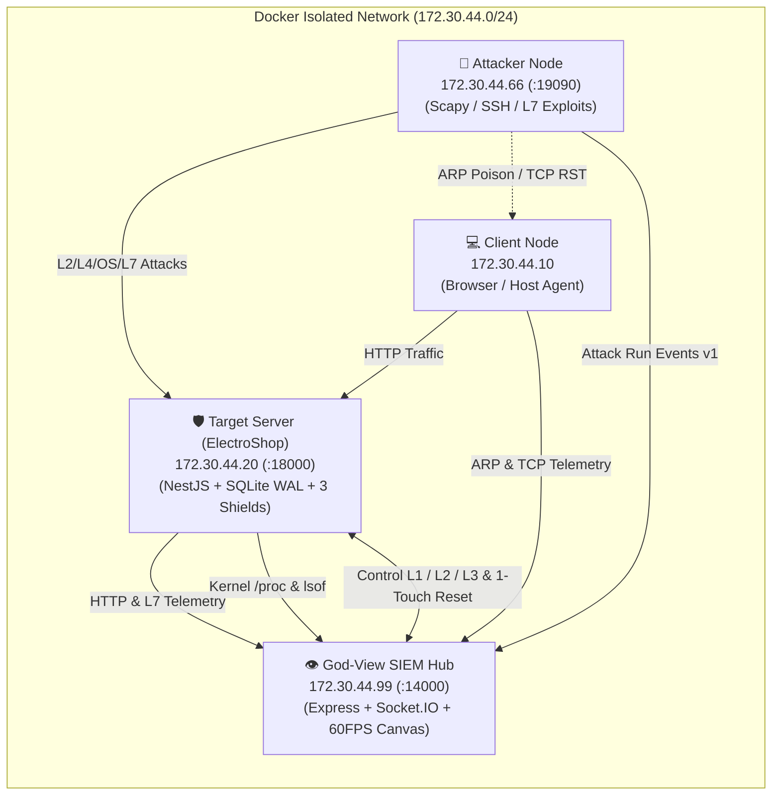

# PBL4 — Hệ Thống Giám Sát & Phòng Thủ Tấn Công Mạng - Hệ Điều Hành Đa Tầng (God-View SIEM)

> **Đồ án Cơ sở ngành Mạng & An toàn thông tin (PBL4)**  
> Hệ thống Lab 4-Node cách ly kết hợp trạm giám sát thời gian thực **God-View SIEM**, trực quan hóa luồng gói tin đa tầng từ **Tầng Liên kết dữ liệu (L2)**, **Tầng Giao vận (L4)**, **Nhân Hệ điều hành (OS/Kernel)** đến **Tầng Ứng dụng (L7)** và **Phễu Phòng thủ Chiều sâu 3 Lớp (Defense-in-Depth)**.

---

## 1. Kiến Trúc Tổng Thể Hệ Thống (4-Node Architecture)

Hệ thống được triển khai trên mạng LAN ảo cách ly của Docker (`pbl4-integration`, subnet mặc định `172.30.44.0/24`) gồm 4 phân hệ độc lập:



| Phân hệ (Node) | IP Nội bộ | Cổng Host (Mặc định) | Vai trò & Công nghệ |
| :--- | :---: | :---: | :--- |
| **God-View SIEM** | `172.30.44.99` | [`http://127.0.0.1:14000`](http://127.0.0.1:14000) | Trạm thu thập Telemetry (`RingBuffer 300`), WebSocket thời gian thực (`Socket.IO`), Đồ họa Isometric Canvas 60 FPS & Điều khiển 3 Lớp Khiên. |
| **Target Server (ElectroShop)** | `172.30.44.20` | [`http://127.0.0.1:18000`](http://127.0.0.1:18000) | Web thương mại điện tử linh kiện điện tử (NestJS + SQLite WAL), tích hợp 5 điểm cắm lỗ hổng L7, Swagger UI (`/api/docs`) & `host_agent.py`. |
| **Attacker Controller** | `172.30.44.66` | [`http://127.0.0.1:19090`](http://127.0.0.1:19090) | Giao diện & REST API điều khiển 6 kịch bản tấn công mạng/HĐH (`S1`–`S6` với Python/Scapy/SSH) và bộ công cụ khai thác L7 (`scripts/attack-l7.mjs`). |
| **Client Node** | `172.30.44.10` | *(Internal)* | Máy trạm người dùng hợp lệ kèm `host_agent.py` trích xuất bảng `/proc/net/arp` và trạng thái socket TCP gửi về God-View. |

---

## 2. Phân Công Nhiệm Vụ Các Thành Viên

* **TV1 — Hạnh Nguyên (God-View SIEM & Real-Time UI/UX):**
  * Xây dựng Backend Ingestion Hub (`god-view/backend`) với bộ đệm vòng `RingBuffer` 300 bản tin trong RAM và kênh phát sóng WebSocket độ trễ thấp.
  * Thiết kế giao diện **Protocol SIEM** (`god-view/frontend`) với đồ họa Isometric 3D, hiệu ứng hạt `requestAnimationFrame` 60 FPS, 6 bảng giám sát chuyên sâu (`ARP Cache`, `MitM Credential Sniffer`, `SYN_RECV Backlog & TCP RST`, `OS pstree`, `lsof File Descriptors Gauge`, `L7 Security Alerts`), thanh tiến trình **Kill Chain 5 giai đoạn** và nút **Reset Lab 1-Chạm (< 3s)**.
* **TV2 — Minh Trí (Hạ tầng Mạng L2/L4 & Nhân Hệ Điều Hành OS/Kernel):**
  * Phát triển phân hệ **Attacker (`S1`–`S6`)** và **Host Telemetry Agent (`integration/host_agent.py`)** đọc trực tiếp `/proc/net/tcp`, `/proc/net/arp`, `lsof`, `pstree`, `cgroups v2`.
  * Thiết kế và kiểm chứng **Khiên Mạng L1** (`Static ARP`, `iptables` lọc bão SYN/RST) và **Khiên HĐH L2** (`tcp_syncookies=1`, `ulimit -n`, `cgroups pids.max`, `nologin`).
* **TV3 — Hoàng Trung (Target App ElectroShop & Tấn công/Phòng thủ Tầng Ứng dụng L7):**
  * Xây dựng ứng dụng **ElectroShop** (`target-app/server` & `target-app/client`) với xác thực JWT, giỏ hàng theo phiên, tải tài liệu kỹ thuật và `TelemetryInterceptor` đẩy log thời gian thực về God-View.
  * Thiết kế 5 kịch bản lỗ hổng L7 (`SQL Injection`, `Low-rate Brute-force`, `OS Command Injection`, `Path Traversal`, `Heavy CPU DoS`) và **Khiên Ứng dụng L3** (`Prepared Statements`, `Dynamic Rate Limiting`, `Input Sanitization`).

---

## 3. Hướng Dẫn Khởi Chạy Nhanh (Quick Start)

### Cách 1: Chạy Toàn Bộ Lab 4-Node bằng Docker Compose

**Yêu cầu:** Docker Engine + Docker Compose v2, Python 3, Node.js >= 22.

```bash
# 1. Khởi tạo file cấu hình & khóa bảo mật cục bộ (integration/.env.local)
./scripts/integration-lab.sh init

# 2. Dựng và khởi chạy cả 4 container (God-View, Target, Attacker, Client)
./scripts/integration-lab.sh up

# 3. Xem danh sách URL truy cập và kiểm tra trạng thái container
./scripts/integration-lab.sh urls
./scripts/integration-lab.sh status
```

Sau khi khởi chạy thành công, mở trình duyệt tại:
* **God-View SIEM Dashboard:** [http://127.0.0.1:14000](http://127.0.0.1:14000)
* **ElectroShop (Client Storefront):** [http://127.0.0.1:18000](http://127.0.0.1:18000)
* **ElectroShop Swagger API Docs:** [http://127.0.0.1:18000/api/docs](http://127.0.0.1:18000/api/docs)
* **Attacker Control Panel:** [http://127.0.0.1:19090](http://127.0.0.1:19090) *(Lấy `LAB_ATTACKER_TOKEN` trong file `integration/.env.local` để kết nối)*

> **Chế độ kết nối 2 máy qua Wi-Fi / Hotspot:**
> ```bash
> ./scripts/integration-lab.sh lan <IP_WIFI_MAY_CHU>
> ./scripts/integration-lab.sh up
> ```
> Xem hướng dẫn chi tiết tại [docs/runbooks/demo-two-machines-hotspot.md](docs/runbooks/demo-two-machines-hotspot.md).

---

### Cách 2: Chạy Từng Phân Hệ Trực Tiếp Trên Máy (Local Development)

1. **Khởi chạy Target Server (ElectroShop — Cổng `8000`):**
   ```bash
   npm --prefix target-app/client ci --ignore-scripts
   npm --prefix target-app/client run build
   npm --prefix target-app/server ci
   npm --prefix target-app/server run start:dev
   ```
2. **Khởi chạy God-View SIEM Hub (Cổng `4000`):**
   ```bash
   npm --prefix god-view/backend ci
   npm --prefix god-view/backend run dev
   ```
3. **Khởi chạy Attacker Controller (Cổng `9000`):**
   ```bash
   npm --prefix attacker ci
   npm --prefix attacker run dev
   ```

---

## 4. Kịch Bản Thực Nghiệm Tấn Công & Phòng Thủ Thời Gian Thực

Giao diện **God-View SIEM** hiển thị **100% lưu lượng thực tế** từ người dùng trên **ElectroShop (Client)** và **Attacker (Hacker)**:

### Bước 1: Thao tác Người dùng Thật trên Client (ElectroShop)
* Mở trang **ElectroShop** ([http://127.0.0.1:18000](http://127.0.0.1:18000)):
  * Bấm lọc danh mục linh kiện, tìm kiếm sản phẩm, thêm sản phẩm vào giỏ hàng hoặc đăng nhập (`engineer_user` / `pass123`).
  * Quan sát trên **God-View SIEM**: Các hạt gói tin màu **xanh ngọc (`NORMAL`)** bay từ `Client Node (.10)` sang `Target Server (.20)` và xuất hiện tức thì dưới bảng **PACKET FLOW**.

### Bước 2: Thực hiện Tấn công Thật từ Hacker (Khi 3 Lớp Khiên đang TẮT)
1. **Tấn công Tầng Ứng dụng L7 (Từ ElectroShop Lab Drawer, Swagger hoặc CLI):**
   * **SQL Injection (Auth Bypass):** Mở khung Đăng nhập trên ElectroShop, nhập username `admin' --` (hoặc chạy `node scripts/attack-l7.mjs --scenario sqli`).
   * **Path Traversal & Rò rỉ Tài liệu Mật:** Truy cập `/api/files/download?name=../../etc/passwd` hoặc tải tài liệu mật R&D số 5 (hoặc chạy `node scripts/attack-l7.mjs --scenario traversal`).
   * **OS Command Injection:** Gọi `/api/system/network-ping?host=127.0.0.1;id` (hoặc chạy `node scripts/attack-l7.mjs --scenario cmdi`).
   * **Heavy CPU DoS & Brute-Force:** Chạy `node scripts/attack-l7.mjs --scenario dos` hoặc `--scenario bruteforce`.
2. **Tấn công Hạ tầng Mạng & Hệ điều hành (Từ Attacker UI `:19090`):**
   * Chọn kịch bản **`S1` (SSH Chain)**, **`S2` (TCP SYN Flood)**, **`S3` (FD Exhaustion `lsof`)**, **`S4` (Sample File Exfiltration)**, **`S5` (ARP Spoofing)**, **`S6` (TCP RST)** và bấm **Bắt đầu (Start)**.
   * Quan sát trên **God-View SIEM**:
     * Các hạt gói tin màu **đỏ (`ATTACK`)** bắn từ `Hacker Node (.66)` sang `Target Server (.20)`.
     * Cột **KILL CHAIN STAGES** bên trái tự động chuyển trạng thái từng bước sang **`💥 COMPROMISED`**.
     * Chuyển sang tab **`L2/L4 & OS/L7 INSPECTOR`** để xem chi tiết bảng ARP bị đầu độc, mật khẩu bị bắt lén trong MitM Sniffer, biểu đồ `SYN_RECV` tăng vọt, nhánh tiến trình độc hại trên `pstree` và đồng hồ `lsof` báo đỏ.

### Bước 3: Bật Phễu Phòng Thủ 3 Lớp (Defense-in-Depth) & Reset Lab 1-Chạm
1. Nhấn nút **`RESET LAB`** ở góc phải trên cùng của God-View để khôi phục toàn bộ CSDL SQLite, bảng ARP, cây tiến trình OS và xóa bộ đệm về trạng thái sạch ban đầu trong `< 3 giây`.
2. Trên bảng **DEFENSE OVERVIEW** (cột phải God-View), bật lần lượt hoặc bấm **`ENABLE ALL 3 SHIELDS`**:
   * **L1 · NETWORK SHIELD:** Chặn đứng `ARP Spoofing`, `SYN Flood`, `TCP RST` ngay tại vòng khiên ngoài cùng (`152px`).
   * **L2 · OS & KERNEL SHIELD:** Kích hoạt `tcp_syncookies=1`, giới hạn `ulimit -n 512` và khóa `nologin` tại vòng khiên giữa (`126px`).
   * **L3 · APPLICATION SHIELD (L7):** Kích hoạt `Prepared Statements` (chống SQLi), `Token Bucket Rate Limit` (chống Brute-force/DoS) và `Input Sanitizer` (chống Command Injection/Path Traversal) tại vòng khiên trong cùng (`98px`).
3. Thực hiện lại các đòn tấn công từ Hacker: Gói tin độc hại sẽ nổ tia lửa, bị **dội ngược lại (Bounce-Back Recoil)** tại đúng lớp khiên tương ứng và cột Kill Chain báo **`🛡️ BLOCKED`**.

---

## 5. Kiểm Thử Tự Động (Automated Verification)

Chạy bộ kiểm thử đơn vị và tích hợp cho từng phân hệ từ thư mục gốc:

```bash
# 1. Kiểm thử God-View SIEM Backend & 12 hợp đồng tích hợp (L1/L2/L3, Kill Chain, 1-Touch Reset)
npm --prefix god-view/backend test

# 2. Kiểm thử Target Server (Unit Tests & 27 kịch bản E2E L7 Defense)
npm --prefix target-app/server test
npm --prefix target-app/server run test:e2e

# 3. Kiểm thử Attacker Controller & Python Workers
npm --prefix attacker test
npm --prefix attacker run test:python

# 4. Kiểm thử toàn diện Lab 4-Node trên Docker (khi lab đang chạy)
./scripts/integration-lab.sh test
```

---

## 6. Cấu Trúc Thư Mục Dự Án

```text
pbl4/
├── compose.integration.yaml      # Cấu hình Docker Compose tích hợp 4-Node
├── god-view/                     # Phân hệ trạm giám sát God-View SIEM (TV1)
│   ├── backend/                  # Express + Socket.IO Hub, RingBuffer, Defense Proxy
│   └── frontend/                 # Giao diện Protocol SIEM, Canvas 60FPS, 6 Telemetry Panels
├── target-app/                   # Phân hệ ứng dụng mục tiêu ElectroShop (TV3)
│   ├── server/                   # NestJS Backend, SQLite WAL, L3 Shields, TelemetryInterceptor
│   ├── client/                   # Giao diện cửa hàng ElectroShop & Lab Drawer
│   └── defense/                  # Script kích hoạt khiên L1/L2 trên container
├── attacker/                     # Phân hệ điều khiển tấn công S1–S6 (TV2)
│   ├── src/                      # Attacker REST API, Run Journal, Telemetry Outbox
│   ├── scripts/                  # Worker Python/Scapy (syn_flood, fd_exhaustion, ssh_chain...)
│   └── public/                   # Giao diện điều khiển Attacker Web UI
├── integration/                  # Agent thu thập Telemetry Kernel (/proc, lsof, arp) & Verify scripts
├── shared/                       # JSON Schema & TypeScript Interfaces dùng chung (@shared/schemas)
├── scripts/                      # Công cụ CLI điều phối Lab (integration-lab.sh, attack-l7.mjs...)
├── docs/                         # Kho tài liệu kiến trúc, API specs, báo cáo học thuật & hướng dẫn thực nghiệm
```

---

## 7. Tài Liệu Tham Chiếu Chi Tiết (`docs/`)

* **Kiến trúc & Hợp đồng Tích hợp:**
  * [Kiến trúc hệ thống 4-Node](docs/architecture/system-architecture.md)
  * [Đặc tả API God-View SIEM](docs/api/god-view/god-view-api.md)
  * [Đặc tả API Target Server (ElectroShop)](docs/api/target-server/target-server-api.md)
  * [Đặc tả API Attacker Controller](docs/api/attacker/attacker-api.md)
* **Kịch bản Tấn công & Phòng thủ 3 Lớp:**
  * [Danh mục kịch bản tấn công S1–S6 & Kill Chain](docs/attacks/attacker-s1-s4.md)
  * [Kịch bản khai thác tầng ứng dụng L7](docs/attacks/l7-attack-scenarios.md)
  * [Phòng thủ Lớp 1 (Network) — Static ARP & iptables](docs/defense/layer1-network-defense.md)
  * [Phòng thủ Lớp 2 (OS/Kernel) — Syncookies, ulimit, cgroups](docs/defense/layer2-os-defense.md)
  * [Phòng thủ Lớp 3 (Application L7) — Prepared SQL, Rate Limit, Sanitizer](docs/defense/layer3-application-defense.md)
* **Runbooks & Báo cáo Bảo vệ Đồ án:**
  * [Hướng dẫn vận hành Lab tích hợp 4-Node](docs/runbooks/integration-lab.md)
  * [Hướng dẫn kết nối 2 máy qua Wi-Fi Hotspot](docs/runbooks/demo-two-machines-hotspot.md)
  * [Báo cáo chuyên sâu God-View SIEM UI](docs/reports/bao-cao-chuyen-sau-god-view-ui.md)
  * [Báo cáo chuyên sâu Target App & L7 Defense](docs/reports/bao-cao-chuyen-sau-l7-target-app.md)
  * [Đề cương Slide & Kịch bản Bảo vệ Đồ án trước Hội đồng](docs/reports/slide-outline-va-kich-ban-bao-ve.md)
