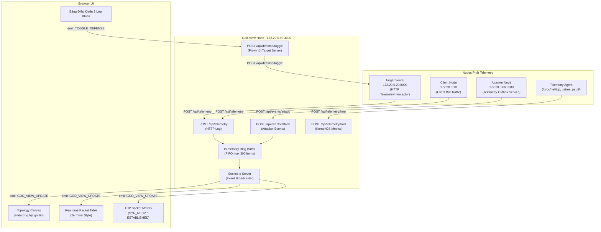

# Đặc Tả API Trạm Giám Sát God-View (God-View SIEM & Telemetry Ingestion API Spec)

> **Node:** `god-view` (Container/Node Giám Sát Trung Tâm, Cổng `4000`)  
> **Người phụ trách:** Hạnh Nguyên (TV1) — *Giao diện Thượng Đế (God-View UI / Frontend UI/UX)*  
> **Tài liệu tham chiếu:** [docs/plan.pdf](../../plan.pdf) (Task W1-T1, W2-T1, W3-T1, W4-T1, W5-T1, W6-T1)  
> **Giao thức:** REST API (HTTP) + WebSocket Stream (`Socket.io`)

---

## 1. Tổng quan kiến trúc Trạm Giám Sát God-View

God-View đóng vai trò là "Trung tâm chỉ huy SIEM" thời gian thực cho toàn bộ hệ thống mô phỏng an toàn mạng PBL4. Nút này đảm nhận 3 nhiệm vụ trọng yếu:

1. **Thu nạp Telemetry đa nguồn (Multi-source Ingestion):**
   - Nhận bản tin HTTP Telemetry Log (`TelemetryLog`) từ Target Server (172.20.0.20) và Client (172.20.0.10).
   - Nhận bản tin Sự kiện Tấn công (`AttackEvent`) từ Hacker Node (172.20.0.66) phục vụ trực quan hóa các đòn đánh S1–S4, ARP Spoofing, SYN Flood, RST Injection.
   - Nhận bản tin đo lường Nhân HĐH & Mạng (`HostMetrics`) từ các daemon Telemetry Agent.
2. **Bộ đệm Ring Buffer & Thống kê Socket trong RAM:**
   - Duy trì bộ đệm tròn FIFO kích thước tối đa 300 bản tin gần nhất (`config.maxBufferSize = 300`) phục vụ tải lại giao diện (F5) tức thì mà không cần truy vấn CSDL nặng nề.
3. **Phát tán Thời gian thực (Real-time WebSocket Broadcast) & Điều khiển Phòng thủ:**
   - Sử dụng Socket.io phát tán tức thì các sự kiện và chỉ số socket (`ESTABLISHED`, `SYN_RECV`, `TIME_WAIT`) xuống Web Dashboard.
   - Đóng vai trò Proxy chuyển tiếp lệnh bật/tắt 3 Lớp Khiên Phòng Thủ từ giao diện xuống Target Server và các node phòng ngự.



---

## 2. Đặc Tả REST API Endpoints

### 2.1. Tiếp nhận Log HTTP (`POST /api/telemetry`)
* **Mô tả:** Điểm tiếp nhận bản tin `TelemetryLog` từ Target Server (được đẩy tự động qua `TelemetryInterceptor`) và Client Node.
* **Schema dữ liệu:** Tuân thủ chuẩn `shared/schemas/telemetry.ts`.
* **Payload Request mẫu:**
  ```json
  {
    "timestamp": "2026-11-21T13:30:00.000Z",
    "method": "POST",
    "endpoint": "/api/auth/login",
    "status_code": 200,
    "response_time": 18,
    "client_ip": "172.20.0.66",
    "payload_summary": {
      "body_preview": { "username": "admin' --" },
      "detected_patterns": ["SQL_INJECTION"]
    },
    "is_suspicious": true,
    "attack_tag": "SQL_INJECTION",
    "defense_action": "allowed"
  }
  ```
* **Response (200 OK):**
  ```json
  {
    "success": true,
    "message": "Telemetry logged and broadcasted successfully.",
    "buffer_size": 42
  }
  ```

---

### 2.2. Tiếp nhận Sự kiện Tấn công (`POST /api/events/attack`)
* **Mô tả:** Điểm tiếp nhận sự kiện từ Attacker Node (phát từ `attacker/src/services/telemetry.ts`). God-View chuyển đổi thông điệp này sang dạng trực quan và kích hoạt hoạt họa hạt gói tin màu đỏ trên sơ đồ mạng.
* **Schema dữ liệu:** Tuân thủ chuẩn `shared/schemas/attacker-event.schema.json`.
* **Payload Request mẫu:**
  ```json
  {
    "schema_version": "1.0",
    "event_id": "8ce23061-e0e9-43cc-a73a-d220565f6a56",
    "run_id": "ab7eb340-9d2b-49f0-a823-d5294cad7bc5",
    "timestamp": "2026-11-21T13:31:00.000Z",
    "source_node": "ATTACKER",
    "source_ip": "172.20.0.66",
    "target_ip": "172.20.0.20",
    "scenario": "S2",
    "event_type": "RUN_STATE",
    "execution_mode": "real",
    "payload": {
      "state": "RUNNING",
      "stage": "FLOODING",
      "measurements": { "sent_count": 500, "rate_pps": 100 }
    }
  }
  ```
* **Response (200 OK):**
  ```json
  {
    "success": true,
    "event_id": "8ce23061-e0e9-43cc-a73a-d220565f6a56",
    "status": "PROCESSED_AND_BROADCASTED"
  }
  ```

---

### 2.3. Tiếp nhận Số liệu Nhân HĐH & Mạng (`POST /api/telemetry/host`)
* **Mô tả:** Điểm tiếp nhận thông số kernel thực tế từ Telemetry Agent chạy trên Target Server hoặc Client Node.
* **Payload Request mẫu:**
  ```json
  {
    "timestamp": "2026-11-21T13:32:00.000Z",
    "node": "target-server",
    "ip": "172.20.0.20",
    "metrics": {
      "tcp_established": 14,
      "tcp_syn_recv": 85,
      "tcp_time_wait": 6,
      "cpu_percent": 68.5,
      "ram_used_mb": 240,
      "open_fds": 112,
      "suspicious_processes": ["/bin/sh -i"]
    }
  }
  ```
* **Response (200 OK):**
  ```json
  {
    "success": true,
    "metrics_updated": true
  }
  ```

---

### 2.4. Lấy Lịch Sử Bộ Đệm (`GET /api/telemetry/history`)
* **Mô tả:** Trả về toàn bộ danh sách bản tin hiện có trong Ring Buffer khi người dùng mở trang hoặc nhấn F5.
* **Response (200 OK):**
  ```json
  {
    "success": true,
    "count": 42,
    "capacity": 300,
    "history": [ /* mảng TelemetryLog */ ],
    "defense_l3_state": true,
    "metrics": {
      "established": 12,
      "syn_recv": 0,
      "time_wait": 4,
      "last_updated": "2026-11-21T13:30:00.000Z"
    }
  }
  ```

---

### 2.5. Xóa Rỗng Bộ Đệm (`DELETE /api/telemetry/clear`)
* **Mô tả:** Xóa rỗng toàn bộ Ring Buffer trong bộ nhớ RAM và đặt lại các đồng hồ đo về trạng thái an toàn ban đầu.
* **Response (200 OK):**
  ```json
  {
    "success": true,
    "message": "Đã xóa rỗng bộ đệm Telemetry Ring Buffer."
  }
  ```

---

### 2.6. Điều khiển Bật/Tắt Phễu Phòng Thủ 3 Lớp (`POST /api/defense/toggle` & `GET /api/defense/status`)
* **Mô tả:** Điều phối trạng thái của cả 3 Lớp Khiên Chắn (**L1 Khiên Mạng**, **L2 Khiên HĐH**, **L3 Khiên Ứng dụng & 3 cờ con**) và đồng bộ trạng thái mới xuống toàn bộ client qua WebSocket (`DEFENSE_TOGGLED`).
* **Request Body (`POST /api/defense/toggle`):**
  - Bật/tắt Khiên Mạng L1: `{ "layer": "l1", "enabled": true }`
  - Bật/tắt Khiên HĐH L2: `{ "layer": "l2", "enabled": true }`
  - Bật/tắt Khiên Ứng dụng L3 (Master): `{ "layer": "l3", "enabled": true }` hoặc `{}`
  - Bật/tắt từng cờ con L3 (Granular Sub-flag): `{ "layer": "l3", "flag": "anti_sqli" | "rate_limit" | "input_sanitization" }`
* **Response trả về cho Client God-View (200 OK):**
  ```json
  {
    "success": true,
    "layer": "l3",
    "defense_l1_network": true,
    "defense_l2_os": true,
    "defense_l3_app": true,
    "defense_layers": {
      "l1_network": true,
      "l2_os": true,
      "l3_app": true,
      "l3_subflags": {
        "anti_sqli": true,
        "rate_limit": true,
        "input_sanitization": true
      },
      "updated_at": "2026-11-24T15:00:00.000Z"
    },
    "current_state": {
      "l3_master": true,
      "anti_sqli": true,
      "rate_limit": true,
      "input_sanitization": true
    },
    "proxied_to_target": true,
    "message": "Khiên phòng thủ L3/L7 hiện đang: BẬT (SECURED)"
  }
  ```

---

### 2.7. Khôi phục Trạng thái Sạch Toàn Hệ Thống — Reset Lab 1-Chạm (`POST /api/lab/reset`)
* **Mô tả (Task W6-T1 & W6-ALL):** Khôi phục nguyên tử toàn bộ hệ thống về trạng thái sạch ban đầu trong **$< 3\text{ giây}$**:
  1. Gọi trực tiếp `POST /api/system/reset` sang Target Server để làm sạch & re-seed CSDL SQLite, xóa bộ đếm Rate Limit và đặt lại cờ Khiên L3.
  2. Khôi phục bảng ARP sạch, tắt MitM Sniffing, đặt lại bộ đếm RST Injection và đưa hàng đợi `SYN_RECV` về `0`.
  3. Ngắt tiến trình Reverse Shell (`/bin/sh -> nc`), đưa cây tiến trình `pstree` và đồng hồ File Descriptors (`lsof` = `42 / 1024`) về trạng thái chuẩn.
  4. Đặt lại Khiên L1, L2, L3, thanh tiến trình Kill Chain 5 giai đoạn và xóa rỗng bộ đệm `RingBuffer`.
* **Response (200 OK):**
  ```json
  {
    "success": true,
    "status": "CLEAN_STATE_RESTORED",
    "message": "Đã khôi phục trạng thái sạch toàn hệ thống (Mạng, HĐH, Target App & 3 Lớp Khiên) trong 18ms.",
    "reset_summary": {
      "network_arp_restored": true,
      "mitm_disabled": true,
      "os_reverse_shell_killed": true,
      "fd_table_reset": true,
      "telemetry_buffer_cleared": true,
      "defense_shields_reset": true,
      "target_app_reset": true,
      "elapsed_ms": 18,
      "within_3s_sla": true,
      "timestamp": "2026-11-24T15:05:00.000Z"
    }
  }
  ```

---

### 2.8. Giám sát & Đặt lại Chuỗi Tấn Công Liên Hoàn 5 Giai Đoạn (`GET /api/killchain/status` & `POST /api/killchain/reset`)
* **Mô tả (Task W6-ALL):** Trả về hoặc đặt lại tiến trình của 5 giai đoạn trong chuỗi Kill Chain (`① Recon & ARP MitM` $\rightarrow$ `② L7 SQLi & Brute-Force` $\rightarrow$ `③ OS Reverse Shell` $\rightarrow$ `④ Data Exfiltration` $\rightarrow$ `⑤ SYN Flood + FD/RST Impact`).

---

## 3. Đặc Tả Kênh WebSocket Stream (`Socket.io`)

God-View phát tán sự kiện thời gian thực tới tất cả các trình duyệt Dashboard đang kết nối qua các kênh sự kiện sau:

| Tên Event | Chiều | Payload | Ý nghĩa |
| :--- | :---: | :--- | :--- |
| `INITIAL_STATE` | Server $\rightarrow$ Client | `{ history, metrics, defense_l3_state, capacity }` | Gửi toàn bộ dữ liệu ban đầu ngay khi socket kết nối thành công. |
| `GOD_VIEW_UPDATE` | Server $\rightarrow$ Client | `{ log, buffer_size, metrics, defense_l3_state }` | Phát bản tin mới khi có request HTTP hoặc đòn tấn công được nạp vào hệ thống. |
| `DEFENSE_TOGGLED` | Server $\rightarrow$ Client | `{ defense_l3_state, current_state, updated_at }` | Thông báo khiên phòng thủ vừa bị bật hoặc tắt (để đổi màu aura khiên trên Canvas). |
| `GOD_VIEW_RESET` | Server $\rightarrow$ Client | `{ message, timestamp }` | Thông báo xóa sạch bảng log và reset trạng thái hoạt họa về ban đầu. |
| `ping_rtt` | Client $\rightarrow$ Server | `{ client_time: number }` | Client gửi timestamp để tính Round-Trip Time (RTT). |
| `pong_rtt` | Server $\rightarrow$ Client | `{ client_time: number, server_time: number }` | Server phản hồi để client tính toán độ trễ đường truyền hiển thị lên Navbar. |
| `TOGGLE_DEFENSE` | Client $\rightarrow$ Server | `{ flag?: string }` | Client gửi yêu cầu đảo khiên phòng thủ trực tiếp qua kênh WebSocket. |

---

## 4. Bảng Định Tuyến Dải Mạng Đồng Nhất (Docker Subnet Mapping)

Toàn bộ thông số hiển thị và xử lý luồng gói tin trên giao diện God-View **bắt buộc tuân thủ dải mạng Docker tĩnh `172.20.0.0/24`**:

| Node | IP Chuẩn | Vai trò trên UI | Màu sắc gói tin / Icon |
| :--- | :--- | :--- | :--- |
| **Client** | `172.20.0.10` | Người dùng hợp lệ (Legitimate User) | Màu xanh lá (`#00ff66`), Icon 💻 |
| **Target Server** | `172.20.0.20` | Máy chủ mục tiêu (Web App + API) | Màu xanh dương (`#00e5ff`) kèm Shield Aura, Icon 🛡️ |
| **Hacker / Attacker** | `172.20.0.66` | Máy kẻ tấn công (Adversary Node) | Màu đỏ neon (`#ff003c`), Icon 💀 |
| **God-View SIEM** | `172.20.0.99` | Trạm quan sát toàn cảnh | Hub trung tâm (Cổng 4000) |
