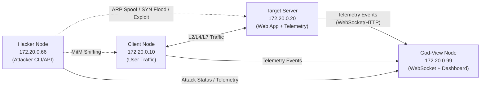
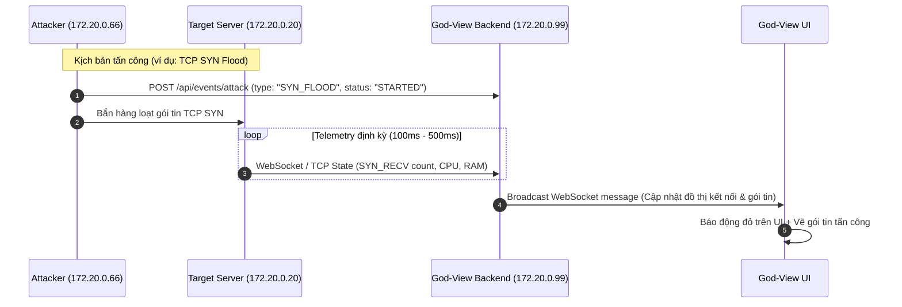

# Kiến Trúc Hệ Thống (System Architecture Spec)
**Dự án:** PBL4 - Hệ Thống Mô Phỏng & Giám Sát Tấn Công Mạng & Hệ Điều Hành (God-View)  
**Tài liệu tham chiếu:** Kế hoạch thực hiện 6 tuần & phân chia nhiệm vụ

---

## 1. Tổng quan hệ thống (System Overview)

Hệ thống được thiết kế nhằm mô phỏng trực quan các kịch bản tấn công mạng, khai thác lỗ hổng hệ điều hành và ứng dụng Web theo thời gian thực dưới góc nhìn toàn cảnh (**God-View**).

Mục tiêu chính:
1. **Mô phỏng đa tầng (Multi-layer Attacks):**
   - **Tầng Mạng (L2/L4):** ARP Spoofing + Man-in-the-Middle (MitM), TCP SYN Flood DoS, TCP RST Injection.
   - **Tầng Hệ Điều Hành & Tiến Trình:** Khai thác Command Injection tạo Reverse Shell, đọc `/etc/passwd`, làm cạn kiệt tài nguyên (CPU/RAM/File Descriptors).
   - **Tầng Ứng Dụng (L7):** Heavy Endpoint DoS, Low-rate Brute Force vượt qua Firewall tầng mạng, Path Traversal.
2. **Giám sát thời gian thực (Real-time Telemetry):**
   - Thu thập trạng thái nhân Linux kernel (`/proc/net/arp`, `ss -tan`, `/proc/net/tcp`).
   - Giám sát tiến trình và tài nguyên hệ thống (`pstree`, CPU, RAM, open files qua `psutil`).
   - Đẩy sự kiện qua WebSocket về dashboard trung tâm với độ trễ thấp.
3. **Phòng thủ đa lớp (Defense-in-Depth Toggle):**
   - Trực quan hóa "3 Lớp Khiên Chắn" cho phép bật/tắt độc lập:
     - **Lớp 1 (Mạng):** Static ARP, iptables/firewall.
     - **Lớp 2 (HĐH/Kernel):** `tcp_syncookies`, `cgroups`, `ulimit`, `nologin`.
     - **Lớp 3 (Ứng dụng):** Rate Limiting theo IP/User, Input Sanitization.

---

## 2. Kiến trúc mạng Docker (Docker Network Topology)

Toàn bộ hệ thống chạy trên một dải mạng Docker bridge chuyên biệt (`isolated-net`) với dải IP tĩnh `172.20.0.0/24`:



### Chi tiết các Node trong mạng:

| Node | IP Tĩnh | Vai trò & Trách nhiệm | Thành viên phụ trách |
| :--- | :--- | :--- | :--- |
| **Client** | `172.20.0.10` | Đóng vai trò người dùng bình thường: gửi request hợp lệ (đăng nhập, tải file), chạy telemetry agent theo dõi ARP/TCP từ phía Client. | **Trung** (TV3) |
| **Target Server** | `172.20.0.20` | Máy chủ mục tiêu chạy Web App (có lỗ hổng L7). Chạy các daemon Telemetry Agent (Network & OS) và chứa các script kích hoạt 3 lớp phòng thủ. | **Trung** (TV3) |
| **Hacker / Attacker** | `172.20.0.66` | Máy kẻ tấn công: chứa công cụ tấn công (Scapy, hping3, arpspoof, tcpkill), module hóa qua CLI/API và gửi sự kiện tấn công về God-View. | **Trí** (TV2) |
| **God-View** | `172.20.0.99` | Trạm giám sát trung tâm: Backend nhận và phân phối telemetry qua WebSocket; Frontend hiển thị topology mạng động, Process Tree và Bảng điều khiển phòng thủ. | **Nguyên** (TV1) |

---

## 3. Cấu trúc thư mục Repo (Directory Architecture)

Cấu trúc dự án được phân định rõ ràng tương ứng với các Node và nhiệm vụ trong kế hoạch 6 tuần:

```text
cybersec-visualize/
├── docker-compose.yml              # Điều phối 4 container, cấu hình subnet 172.20.0.0/24
├── .env.example                    # Cấu hình biến môi trường mẫu
├── .gitignore                      # Loại trừ file rác, log, virtual environment, node_modules
├── CONTRIBUTING.md                 # Quy tắc phân nhánh, commit và Pull Request
├── README.md                       # Giới thiệu dự án và hướng dẫn khởi chạy nhanh
│
├── attacker/                       # [Node Hacker - 172.20.0.66]
│   ├── scripts/                    # Scripts demo tấn công dạng dòng lệnh (Scapy, hping3, arpspoof)
│   └── src/                        # Module tấn công được đóng gói (gọi qua CLI/API, phát telemetry)
│
├── target-system/                  # [Node Target Server & Client - 172.20.0.20 & 172.20.0.10]
│   ├── app/                        # Ứng dụng Web Store (Login, Heavy API, Download, lỗ hổng L7)
│   ├── agents/                     # Telemetry Agents thu thập trạng thái hệ thống:
│   │   ├── network_agent           # Đọc định kỳ /proc/net/arp, /proc/net/tcp, ss -tan
│   │   └── os_agent                # Đọc Process Tree (pstree), CPU/RAM, File Descriptors (lsof)
│   ├── docker/                     # Dockerfile cho Server và Client, cấu hình sysctl kernel
│   └── defense/                    # Scripts bật/tắt 3 lớp khiên phòng thủ (iptables, syncookies, rate-limit)
│
├── god-view/                       # [Node God-View - 172.20.0.99]
│   ├── backend/                    # Server tiếp nhận Telemetry và phát thời gian thực qua WebSocket
│   └── frontend/                   # Giao diện Web:
│       ├── topology/               # Sơ đồ mạng động (Client - Router - Server - Hacker) & hiệu ứng gói tin
│       ├── host-metrics/           # Đồng hồ CPU/RAM, Bảng ARP cache, Biểu đồ kết nối TCP, Cây tiến trình
│       └── control-panel/          # Bảng điều khiển bật/tắt 3 Lớp Khiên Chắn (Defense Toggle)
│
├── shared/                         # Dữ liệu và quy chuẩn dùng chung giữa các container
│   ├── schemas/                    # JSON Schema quy định cấu trúc gói tin Telemetry Event
│   └── pcap/                       # Lưu trữ file bắt gói tin mẫu (.pcap) để phân tích
│
├── scripts/                        # Scripts tự động hóa chạy từ máy host
│   ├── setup-env.sh                # Kiểm tra dependency Docker, cấu hình sysctl máy host
│   └── reset-lab.sh                # Script 1 lệnh tự động làm sạch và khôi phục trạng thái ban đầu
│
└── docs/                           # Tài liệu kỹ thuật dự án
    ├── architecture/               # Thông số kỹ thuật kiến trúc hệ thống (file này)
    └── plan.pdf                    # Kế hoạch chi tiết 6 tuần cập nhật của nhóm
```

---

## 4. Chuẩn giao tiếp Telemetry (Event Communication Flow)

Mọi sự kiện từ **Target Server**, **Client**, và **Hacker** được chuẩn hóa dưới dạng JSON payload (định nghĩa tại `shared/schemas/`) và gửi về **God-View Backend**:



---