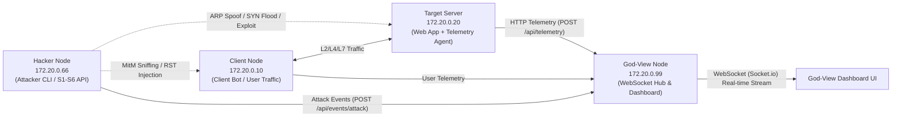
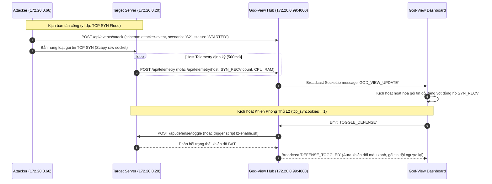

# Kiến Trúc Hệ Thống (System Architecture Spec)
**Dự án:** PBL4 - Hệ Thống Mô Phỏng & Giám Sát Tấn Công Mạng & Hệ Điều Hành (God-View)  
**Tài liệu tham chiếu:** [docs/plan.pdf](../plan.pdf) (Kế hoạch 6 tuần & phân chia nhiệm vụ)

---

## 1. Tổng quan hệ thống (System Overview)

Hệ thống được thiết kế nhằm mô phỏng trực quan các kịch bản tấn công mạng, khai thác lỗ hổng hệ điều hành và ứng dụng Web theo thời gian thực dưới góc nhìn toàn cảnh (**God-View SIEM**).

Mục tiêu chính:
1. **Mô phỏng đa tầng (Multi-layer Attacks):**
   - **Tầng Mạng (L2/L4):**
     - ARP Spoofing + Man-in-the-Middle (MitM) Sniffing đánh cắp phiên đăng nhập/JWT.
     - TCP SYN Flood DoS làm tràn hàng đợi kết nối nửa mở (SYN Backlog Queue).
     - TCP RST Injection giả mạo cờ RST ngắt kết nối hợp lệ của người dùng.
   - **Tầng Hệ Điều Hành & Tiến Trình (OS & Kernel):**
     - Khai thác OS Command Injection mở Reverse Shell chiếm quyền điều khiển (`/bin/sh`, `nc`).
     - Đọc trộm file cấu hình hệ thống (`/etc/passwd`, `/proc/self/environ`).
     - Tấn công làm cạn kiệt tài nguyên hệ thống (File Descriptors Exhaustion / RLIMIT_NOFILE).
   - **Tầng Ứng Dụng (L7):**
     - SQL Injection bypass đăng nhập không cần mật khẩu.
     - Path Traversal leo thang thư mục đọc dữ liệu nhạy cảm.
     - Heavy Endpoint DoS (vắt kiệt CPU qua vòng băm SHA-256).
     - Rò rỉ tài liệu mật (Confidential Blueprint Data Exfiltration).
   - **Chuỗi Tấn Công Liên Hoàn (Kill Chain - Tuần 6):**
     - Do thám (Reconnaissance) $\rightarrow$ Chiếm quyền OS (Command Injection / Reverse Shell) $\rightarrow$ Đánh cắp dữ liệu (Data Exfiltration) $\rightarrow$ Phá hủy dịch vụ (DoS / SYN Flood) $\rightarrow$ Thử thách cơ chế tự vệ 3 lớp.
2. **Giám sát thời gian thực (Real-time Telemetry):**
   - Thu thập trạng thái nhân Linux kernel (`/proc/net/arp`, `ss -tan`, `/proc/net/tcp`).
   - Giám sát tiến trình và tài nguyên hệ thống (`pstree`, CPU, RAM, open files qua `lsof` / `psutil`).
   - Đẩy sự kiện qua WebSocket về dashboard trung tâm với độ trễ thấp.
3. **Phòng thủ đa lớp (Defense-in-Depth Toggle):**
   - Trực quan hóa "3 Lớp Khiên Chắn" cho phép bật/tắt độc lập:
     - **Lớp 1 (Mạng):** Static ARP, iptables rate-limit. Xem chi tiết tại [layer1-network-defense.md](../defense/layer1-network-defense.md).
     - **Lớp 2 (HĐH/Kernel):** `tcp_syncookies = 1`, `ulimit` RLIMIT_NOFILE, `cgroups`, `nologin`. Xem chi tiết tại [layer2-os-defense.md](../defense/layer2-os-defense.md).
     - **Lớp 3 (Ứng dụng):** Prepared Statement, Dynamic Rate Limiting, Input Sanitization. Xem chi tiết tại [layer3-application-defense.md](../defense/layer3-application-defense.md).

---

## 2. Kiến trúc mạng Docker (Docker Network Topology)

Toàn bộ hệ thống chạy trên một dải mạng Docker bridge chuyên biệt (`isolated-net`) với dải IP tĩnh `172.20.0.0/24`:



### Chi tiết các Node trong mạng:

| Node | IP Tĩnh | Vai trò & Trách nhiệm | Thành viên phụ trách |
| :--- | :--- | :--- | :--- |
| **Client** | `172.20.0.10` | Đóng vai trò người dùng bình thường: chạy script `client-bot` gửi request hợp lệ (đăng nhập, tải file), làm "con mồi" cho MitM/RST và chạy telemetry agent theo dõi ARP/TCP từ phía Client. | **Hoàng Trung** (TV3) |
| **Target Server** | `172.20.0.20` | Máy chủ mục tiêu chạy Web App NestJS (ElectroShop) chứa các điểm cắm lỗ hổng L7 & Command Injection. Chạy các daemon Telemetry Agent (Network & OS) và chứa các script kích hoạt 3 lớp phòng thủ. | **Hoàng Trung** (TV3) |
| **Hacker / Attacker** | `172.20.0.66` | Máy kẻ tấn công: chứa công cụ tấn công (Scapy, Python workers S1–S4, ARP/RST), module hóa qua CLI/API và tự động bắn sự kiện tấn công về God-View. | **Minh Trí** (TV2) |
| **God-View SIEM** | `172.20.0.99` | Trạm giám sát trung tâm: Backend Node.js tiếp nhận Telemetry đa nguồn và phân phối qua WebSocket Socket.io; Frontend hiển thị topology mạng động, Bảng điều khiển 3 Lớp Khiên Chắn và Packet Stream. | **Hạnh Nguyên** (TV1) |

---

## 3. Cấu trúc thư mục Repo (Directory Architecture)

```text
cybersec-visualize/
├── docker-compose.yml              # Điều phối 4 container, cấu hình subnet 172.20.0.0/24
├── .env.example                    # Cấu hình biến môi trường mẫu
├── .gitignore                      # Loại trừ file rác, log, virtual environment, node_modules
├── CONTRIBUTING.md                 # Quy tắc phân nhánh Gitflow, commit và Pull Request
├── README.md                       # Giới thiệu dự án và hướng dẫn khởi chạy nhanh
│
├── attacker/                       # [Node Hacker - 172.20.0.66] (Minh Trí - TV2)
│   ├── scripts/                    # Scripts Python tấn công (ssh_chain, syn_flood, fd_exhaustion, sample_transfer)
│   ├── src/                        # Controller TypeScript API v1, CLI, Outbox Telemetry Service
│   └── tests/                      # Bộ kiểm thử tự động và Docker test fixture 4-node
│
├── target-app/                     # [Node Target Server & Client - 172.20.0.20 & 172.20.0.10] (Hoàng Trung - TV3)
│   ├── server/                     # Backend NestJS (ElectroShop E-Commerce & L7 Defense Testbed)
│   │   ├── src/modules/auth/       # Đăng nhập & Lỗ hổng SQL Injection (Prepared Statement defense)
│   │   ├── src/modules/defense/    # Khiên L3 Master & DynamicRateLimitGuard
│   │   ├── src/modules/files/      # Tải file & Lỗ hổng Path Traversal
│   │   ├── src/modules/system/     # Health check, Latency ping & Lỗ hổng Command Injection
│   │   └── src/modules/documents/  # Datasheets & Rò rỉ tài liệu mật (Confidential Blueprint)
│   ├── client/                     # Frontend Web ElectroShop (HTML/CSS/JS)
│   ├── agents/                     # Telemetry Agents đọc /proc/net/arp, /proc/net/tcp, psutil, pstree
│   ├── docker/                     # Dockerfile cho Server và Client
│   └── defense/                    # Scripts Shell bật/tắt Lớp 1 (iptables) và Lớp 2 (sysctl syncookies)
│
├── god-view/                       # [Node God-View - 172.20.0.99] (Hạnh Nguyên - TV1)
│   ├── backend/                    # Hub tiếp nhận Telemetry HTTP & WebSocket Server (Socket.io)
│   └── frontend/                   # Dashboard Web SIEM: Topology canvas, Packet Table, Defense Toggle
│
├── shared/                         # Dữ liệu và quy chuẩn dùng chung giữa các container
│   ├── schemas/                    # JSON Schema & TypeScript Interfaces:
│   │   ├── telemetry.ts            # Schema TelemetryLog cho HTTP requests & Host metrics
│   │   └── attacker-event.schema.json # Schema AttackEvent cho các đòn đánh S1-S6
│   └── pcap/                       # Lưu trữ file bắt gói tin mẫu (.pcap) phục vụ phân tích Wireshark
│
├── scripts/                        # Scripts tự động hóa chạy từ máy host
│   ├── setup-env.sh                # Kiểm tra dependency Docker, cấu hình sysctl máy host
│   └── reset-lab.sh                # Script 1 lệnh tự động làm sạch và khôi phục trạng thái ban đầu
│
└── docs/                           # Tài liệu kỹ thuật dự án (Theo kế hoạch plan.pdf)
    ├── architecture/               # Kiến trúc hệ thống & đặc tả mạng (File này)
    ├── api/                        # Đặc tả API các phân hệ (Target Server, Attacker, God-View)
    ├── attacks/                    # Kịch bản tấn công S1-S6 và Kill Chain
    ├── defense/                    # Đặc tả cơ chế phòng thủ 3 lớp (L1 Network, L2 OS, L3 App)
    ├── runbooks/                   # Hướng dẫn thực nghiệm demo trước hội đồng chấm
    ├── pcap-analysis/              # Báo cáo bóc tách gói tin Wireshark & Cơ chế nhân Linux
    └── plan.pdf                    # Bảng kế hoạch 6 tuần chính thức đã duyệt
```

---

## 4. Chuẩn giao tiếp Telemetry (Event Communication Flow)

Mọi sự kiện từ **Target Server**, **Client**, và **Hacker** được chuẩn hóa dưới dạng JSON payload (định nghĩa tại `shared/schemas/`) và gửi về **God-View Hub (Port 4000)**:


