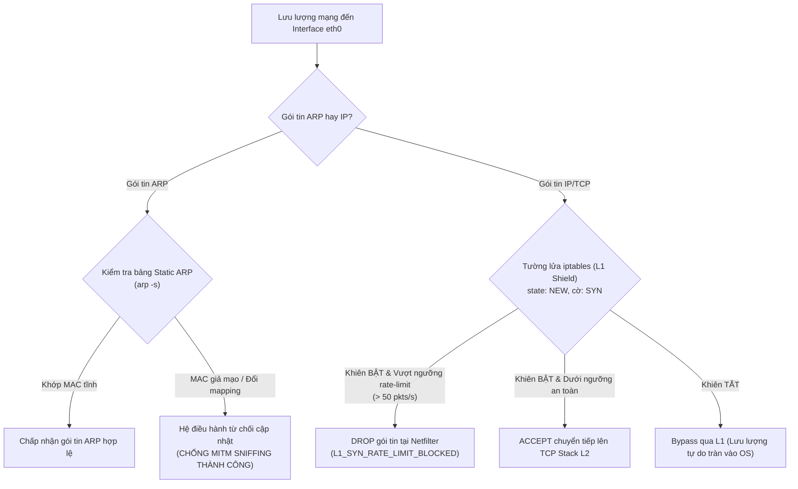

# Cơ Chế Phòng Thủ Lớp 1 — Tầng Mạng (Layer 1 Network Defense / L1 Shield)

> **Phụ trách:** Minh Trí (TV2) — *Tấn công & Hạ tầng Mạng + HĐH*  
> **Dự án:** PBL4 — Hệ thống Mô phỏng & Giám sát Tấn công Mạng & Hệ điều hành (God-View)  
> **Tài liệu tham chiếu:** [docs/plan.pdf](../../plan.pdf) (Task W1-T2, W3-T2, W5-T2, W6-T2)  
> **Phạm vi triển khai:** Máy chủ `target-server` (172.20.0.20) và `client` (172.20.0.10)

---

## 1. Đặt vấn đề: Vai trò của Khiên Lớp 1 (Network Layer)

Trong kiến trúc **Phòng thủ Chiều sâu (Defense-in-Depth)** 3 lớp của PBL4:
* **Lớp 1 (Mạng):** Chốt chặn đầu tiên lọc các gói tin dị thường ở tầng liên kết dữ liệu (L2 - Data Link) và tầng giao vận (L4 - Transport).
* **Mục tiêu bảo vệ:**
  1. **Chống ARP Cache Poisoning (L2):** Ngăn chặn kẻ tấn công (172.20.0.66) gửi các bản tin ARP Reply giả mạo để chiếm đoạt vị trí đứng giữa (Man-in-the-Middle) giữa Client và Server.
  2. **Chống bão gói tin TCP SYN Flood (L4):** Sử dụng tường lửa `iptables` / `nftables` giới hạn tốc độ gói SYN đến cổng 8000, ngăn chặn việc làm nghẽn hàng đợi kết nối nửa mở (SYN Backlog Queue) của máy chủ trước khi nó chạm tới socket của ứng dụng.
  3. **Chống TCP RST Injection (L4):** Chặn các gói tin chứa cờ RST giả mạo ngoài luồng kết nối đang hợp lệ để ngắt kết nối người dùng.

---

## 2. Kiến trúc & Cơ chế kỹ thuật Khiên Lớp 1



---

## 3. Chi tiết 3 Kỹ thuật Bảo vệ Tầng Mạng

### 3.1. Thiết lập Bảng ARP Cố Định (Static ARP Binding)
- **Nguyên lý:** Mặc định, Linux tự động cập nhật bảng ARP cache (`/proc/net/arp`) khi nhận được bất kỳ bản tin ARP reply nào (Dynamic ARP). Kẻ tấn công lợi dụng điểm yếu này để gửi ARP reply giả (`arpspoof`) ánh xạ IP Target Server về MAC của Hacker.
- **Cơ chế phòng thủ:**
  - Cấu hình ánh xạ IP $\leftrightarrow$ MAC tĩnh bất biến trên cả Client và Server:
    ```bash
    # Gán cố định IP và MAC hợp lệ của Gateway / Server vào bảng ARP
    arp -s 172.20.0.20 02:42:ac:14:00:14
    arp -s 172.20.0.10 02:42:ac:14:00:0a
    ```
  - Khi đã gán cờ `CM` (Permanent/Static), nhân Linux sẽ **từ chối đè MAC mới** khi Hacker bắn gói ARP giả mạo, bảo vệ toàn vẹn luồng dữ liệu Client $\leftrightarrow$ Server.

---

### 3.2. Tường lửa lọc bão gói tin TCP SYN (`iptables` Rate Limiting)
- **Nguyên lý:** Kịch bản tấn công SYN Flood (Scapy/hping3) bắn hàng nghìn gói SYN mỗi giây với địa chỉ IP nguồn ngẫu nhiên.
- **Cơ chế phòng thủ:**
  - Kích hoạt quy tắc `iptables` tại chain `INPUT` giới hạn số lượng gói SYN mới:
    ```bash
    # 1. Tạo chain kiểm soát SYN Rate
    iptables -N SYN_FLOOD_LIMIT
    
    # 2. Điều hướng các gói SYN thiết lập kết nối mới vào chain
    iptables -A INPUT -p tcp --dport 8000 --syn -m state --state NEW -j SYN_FLOOD_LIMIT
    
    # 3. Cho phép tối đa 50 gói/giây, vượt quá ngưỡng burst 100 gói sẽ bị DROP ngay tại kernel
    iptables -A SYN_FLOOD_LIMIT -m limit --limit 50/s --limit-burst 100 -j RETURN
    iptables -A SYN_FLOOD_LIMIT -j DROP
    ```
  - Gói tin bị DROP ngay tại tầng Driver/Netfilter, không tiêu tốn tài nguyên cấp phát bộ nhớ socket `struct sock` của hệ điều hành.

---

### 3.3. Bộ Scripts Điều Khiển Khiên Lớp 1 (`target-app/defense/`)
Để phục vụ việc bật/tắt khiên phục vụ kịch bản demo và kiểm thử chéo:

1. **Bật Khiên Lớp 1 (`target-app/defense/l1-enable.sh`):**
   ```bash
   #!/bin/bash
   echo "[L1 SHIELD] Bật bảo vệ tầng Mạng (Static ARP & iptables SYN Filter)..."
   # Áp dụng static ARP
   arp -s 172.20.0.10 02:42:ac:14:00:0a 2>/dev/null || true
   # Áp dụng iptables
   iptables -A INPUT -p tcp --dport 8000 --syn -m limit --limit 50/s --limit-burst 100 -j ACCEPT
   iptables -A INPUT -p tcp --dport 8000 --syn -j DROP
   echo "L1_NETWORK_SHIELD=ACTIVE"
   ```
2. **Tắt Khiên Lớp 1 (`target-app/defense/l1-disable.sh`):**
   ```bash
   #!/bin/bash
   echo "[L1 SHIELD] Tắt bảo vệ tầng Mạng (Mở thông cổng cho thử nghiệm DoS)..."
   iptables -D INPUT -p tcp --dport 8000 --syn -m limit --limit 50/s --limit-burst 100 -j ACCEPT 2>/dev/null || true
   iptables -D INPUT -p tcp --dport 8000 --syn -j DROP 2>/dev/null || true
   echo "L1_NETWORK_SHIELD=BYPASSED"
   ```

---

## 4. Kịch bản Kiểm thử chéo (Cross-Layer Verification)

* **Thử nghiệm A (Bật L1, Tắt L3):**
  - Attacker bắn bão SYN Flood $\rightarrow$ Khiên L1 chặn đứng, server vẫn phản hồi HTTP bình thường.
  - Tuy nhiên, Attacker gửi 1 gói HTTP mang payload SQLi `admin' --` $\rightarrow$ **Khiên L1 không thể chặn vì gói tin SYN hoàn toàn hợp lệ**, hacker vượt qua L1 để khai thác ứng dụng.
* **Kết luận khoa học:** Minh chứng luận điểm *"Phòng thủ một lớp ở Tầng Mạng là không đủ để bảo vệ ứng dụng Web"*.
