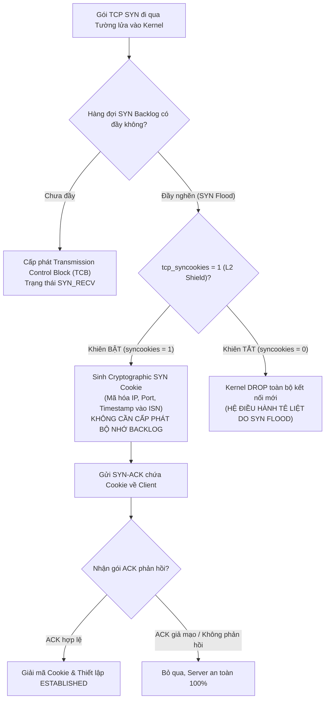

# Cơ Chế Phòng Thủ Lớp 2 — Tầng Hệ Điều Hành & Nhân Kernel (Layer 2 OS & Kernel Defense / L2 Shield)

> **Phụ trách:** Minh Trí (TV2) — *Tấn công & Hạ tầng Mạng + HĐH*  
> **Dự án:** PBL4 — Hệ thống Mô phỏng & Giám sát Tấn công Mạng & Hệ điều hành (God-View)  
> **Tài liệu tham chiếu:** [docs/plan.pdf](../../plan.pdf) (Task W1-T2, W4-T2, W5-T2, W6-T2)  
> **Phạm vi triển khai:** Nhân Linux (Kernel TCP/IP Stack, Procfs, Cgroups, Ulimit) trên `target-server` (172.20.0.20)

---

## 1. Đặt vấn đề: Vai trò của Khiên Lớp 2 (OS & Kernel Layer)

Khi kẻ tấn công vượt qua được tầng mạng L1 (hoặc khi tấn công bằng các kết nối phân tán tốc độ thấp lách qua firewall), gánh nặng an ninh dồn lên **Hệ điều hành và Nhân Linux (Kernel)**:
1. **Tràn hàng đợi SYN Backlog:** Kẻ tấn công gửi gói SYN nhưng không bao giờ trả lời ACK, khiến hàng đợi nửa mở đầy nghẽn và từ chối mọi người dùng mới.
2. **Cạn kiệt File Descriptors (FD Exhaustion / S3):** Hacker chiếm quyền hoặc tạo tiến trình mở hàng loạt file/socket chạm trần `RLIMIT_NOFILE`, khiến web server không thể mở thêm kết nối socket mới (lỗi `EMFILE: too many open files`).
3. **Chiếm quyền thực thi Shell (Reverse Shell):** Khi ứng dụng bị dính lỗi Command Injection, nếu máy chủ chạy với quyền root và có shell tương tác (`/bin/sh`, `/bin/bash`), hacker sẽ chiếm toàn quyền kiểm soát hệ thống.

---

## 2. Kiến trúc & Cơ chế kỹ thuật Khiên Lớp 2



---

## 3. Chi tiết 4 Kỹ thuật Phòng Thủ Tầng Hệ Điều Hành

### 3.1. Thuật toán Cryptographic TCP SYN Cookies (`tcp_syncookies = 1`)
- **Mã lệnh nhân:** `sysctl -w net.ipv4.tcp_syncookies=1`
- **Nguyên lý hoạt động:**
  - Khi hàng đợi `tcp_max_syn_backlog` bị lấp đầy bởi các gói SYN độc hại, thay vì từ chối kết nối, kernel chuyển sang chế độ không trạng thái (stateless):
  - Số thứ tự tuần tự ban đầu (ISN - Initial Sequence Number) trong gói SYN-ACK được tính bằng hàm băm mật mã:
    $$\text{ISN} = \text{Hash}(\text{Client IP}, \text{Client Port}, \text{Server IP}, \text{Server Port}, \text{Secret Key}) + \text{Timestamp} + \text{MSS Index}$$
  - Máy chủ không lưu giữ bất kỳ dữ liệu nào trong RAM cho kết nối này. Chỉ khi Client trả về gói `ACK` mang đúng số thứ tự $\text{ISN} + 1$, Server mới giải mã và tái tạo lại kết nối. Bão SYN Flood bị vô hiệu hóa hoàn toàn!

---

### 3.2. Giới hạn Bộ mô tả Tệp tiến trình (`RLIMIT_NOFILE` / `ulimit`)
- **Nguyên lý:** Chống kịch bản tấn công S3 (FD Exhaustion).
- **Cơ chế:**
  - Giới hạn số lượng file descriptors mà một tiến trình con hoặc người dùng không đặc quyền có thể mở:
    ```bash
    # Đặt giới hạn mềm (soft) và giới hạn cứng (hard) cho user lab
    ulimit -n 256
    ```
  - Cấu hình file `/etc/security/limits.conf`:
    ```text
    lab          soft    nofile          256
    lab          hard    nofile          512
    ```
  - Khi tiến trình probe của hacker cố mở FD thứ 257, kernel lập tức trả về mã lỗi `EMFILE` (Error Maximum Files) và ngăn chặn việc làm cạn kiệt bảng file descriptor toàn cục của hệ thống (`/proc/sys/fs/file-nr`).

---

### 3.3. Giới hạn Tài nguyên Bộ nhớ & CPU bằng Control Groups (`cgroups v2`)
- **Nguyên lý:** Chống tấn công Fork Bomb và Heavy Calculation DoS.
- **Cơ chế:**
  - Gán nhóm tiến trình ứng dụng vào cgroup chuyên biệt có ngưỡng trần:
    - `cpu.max = 50000 100000` (Giới hạn tối đa 50% một nhân CPU).
    - `memory.max = 256M` (Giới hạn trần RAM ở mức 256 MB, tự động trigger OOM Killer đối với tiến trình con sinh sôi bất thường).
    - `pids.max = 50` (Giới hạn tối đa 50 tiến trình, chặn đứng Fork Bomb `:(){ :|:& };:`).

---

### 3.4. Vô hiệu hóa Shell cho Người dùng Dịch vụ (`/sbin/nologin`)
- **Cơ chế:**
  - Tài khoản chạy Web Server (`target-app`) tuyệt đối không chạy dưới quyền `root`.
  - Gán shell mặc định của user thực thi là `/sbin/nologin` hoặc `/bin/false`:
    ```bash
    usermod -s /sbin/nologin appuser
    ```
  - Khi hacker khai thác thành công lỗ hổng Command Injection để gọi `/bin/sh` hoặc `nc -e`, kernel lập tức ngắt phiên thực thi vì user không có quyền tương tác shell.

---

## 4. Bộ Scripts Điều Khiển Khiên Lớp 2 (`target-app/defense/`)

1. **Bật Khiên Lớp 2 (`target-app/defense/l2-enable.sh`):**
   ```bash
   #!/bin/bash
   echo "[L2 SHIELD] Bật bảo vệ tầng HĐH & Nhân Linux (tcp_syncookies & ulimit)..."
   sysctl -w net.ipv4.tcp_syncookies=1
   sysctl -w net.ipv4.tcp_max_syn_backlog=128
   echo "L2_OS_SHIELD=ACTIVE"
   ```
2. **Tắt Khiên Lớp 2 (`target-app/defense/l2-disable.sh`):**
   ```bash
   #!/bin/bash
   echo "[L2 SHIELD] Tắt bảo vệ tầng HĐH (Tắt tcp_syncookies để mô phỏng sập kernel)..."
   sysctl -w net.ipv4.tcp_syncookies=0
   echo "L2_OS_SHIELD=BYPASSED"
   ```
