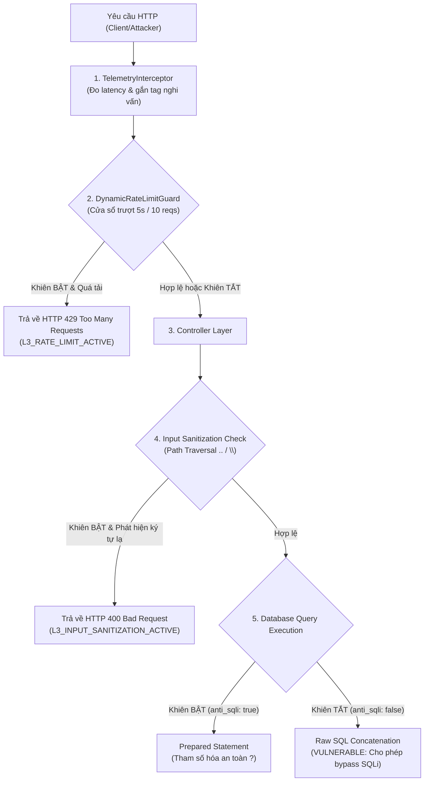

# Cơ Chế Phòng Thủ Lớp 3 — Tầng Ứng Dụng (Layer 3 Application Defense / L3 Shield)

> **Phụ trách:** Hoàng Trung (TV3) & Hạnh Nguyên (TV1)  
> **Dự án:** PBL4 — Hệ thống Mô phỏng & Giám sát Tấn công Mạng & Hệ điều hành (God-View)  
> **Phạm vi triển khai:** Máy chủ ứng dụng `target-app/server` (NestJS)

---

## 1. Đặt vấn đề: Tại sao cần Phòng thủ Lớp 3 (L7 / Tầng Ứng dụng)?

Trong kiến trúc **Phòng thủ Chiều sâu (Defense-in-Depth)** của đề tài PBL4, hệ thống được bảo vệ bởi 3 lớp:
1. **Lớp 1 (Network Layer):** Static ARP chống ARP Spoofing, cấu hình tường lửa iptables chống SYN Flood.
2. **Lớp 2 (OS Layer):** `tcp_syncookies = 1`, giới hạn tài nguyên `cgroups`/`ulimit`, bảo mật nhân Linux.
3. **Lớp 3 (Application Layer):** Bảo vệ các lỗ hổng logic nghiệp vụ web (SQL Injection, Path Traversal, L7 DoS / Brute-force).

**Lỗ hổng thực tế:** Tường lửa L1 và nhân Linux L2 **hoàn toàn mù tịt (blind)** trước nội dung của các gói tin HTTP application layer:
- Gói tin HTTP mang payload SQLi `admin' --` vẫn là một gói tin TCP hợp lệ (SYN $\rightarrow$ SYN-ACK $\rightarrow$ ACK $\rightarrow$ PUSH-ACK). Tường lửa mạng L1 không thể chặn vì nó không hiểu cú pháp SQL.
- Tương tự, một cuộc tấn công L7 DoS (gửi liên tục các request yêu cầu CPU tính toán SHA-256) trông hoàn toàn giống như hành vi của người dùng duyệt web bình thường.

Do đó, **Khiên L3 tại Tầng Ứng dụng** là chốt chặn cuối cùng và quan trọng nhất để bảo vệ an toàn toàn vẹn dữ liệu cho Target Server.

---

## 2. Kiến trúc Khiên L3 (L3 Shield Architecture)

Khiên L3 được xây dựng xoay quanh **`DefenseService`** và các Guards / Interceptors chạy trong pipeline xử lý của NestJS:



---

## 3. Chi tiết 4 Cơ chế Bảo vệ của Khiên L3

### 3.1. Chống SQL Injection (Anti-SQLi)
- **Mã nguồn:** [`auth.service.ts`](file:///D:/Project Github/PBL4/target-app/server/src/modules/auth/auth.service.ts)
- **Nguyên lý:**
  - **Khi tắt khiên (`anti_sqli = false`):** Ứng dụng ghép chuỗi SQL trực tiếp:
    ```typescript
    const rawSql = `SELECT id, username, role FROM users WHERE username = '${dto.username}' AND password = '${dto.password}'`;
    users = this.db.rawQuery(rawSql);
    ```
    Hacker truyền `admin' --` sẽ biến câu lệnh thành:
    ```sql
    SELECT id, username, role FROM users WHERE username = 'admin' --' AND password = '...';
    ```
    Đoạn sau dấu `--` bị CSDL xem là chú thích và bỏ qua, dẫn đến việc đăng nhập lậu thành công.
  - **Khi bật khiên (`anti_sqli = true`):** Ứng dụng bắt buộc sử dụng **Prepared Statement**:
    ```typescript
    users = this.db.query(
      'SELECT id, username, role FROM users WHERE username = ? AND password = ?',
      [dto.username, dto.password],
    );
    ```
    Toàn bộ chuỗi `admin' --` được xem là giá trị thuần của cột `username`, loại bỏ hoàn toàn khả năng can thiệp vào cấu trúc cú pháp của câu lệnh SQL. Kẻ tấn công bị từ chối với mã lỗi 401.

---

### 3.2. Giới hạn tần suất động (Dynamic Rate Limiting)
- **Mã nguồn:** [`dynamic-rate-limit.guard.ts`](file:///D:/Project Github/PBL4/target-app/server/src/modules/defense/guards/dynamic-rate-limit.guard.ts)
- **Thuật toán:** **Cửa sổ trượt theo thời gian thực (Sliding Window Log)**:
  - Mỗi IP được lưu một mảng các mốc thời gian (`timestamps[]`) trong bộ nhớ RAM.
  - Cấu hình ngưỡng (lấy từ biến môi trường):
    - `RATE_LIMIT_WINDOW_MS = 5000` (Cửa sổ 5 giây).
    - `RATE_LIMIT_MAX_REQUESTS = 10` (Tối đa 10 requests / 5 giây).
  - Khi request mới tới: Lọc bỏ các timestamp cũ hơn 5 giây trước. Nếu số lượng request còn lại $\ge 10$, lập tức ném ngoại lệ `HttpException(429 Too Many Requests)` kèm cờ `shield: 'L3_RATE_LIMIT_ACTIVE'`.
  - **Mô phỏng DoS:** Khi tắt cờ `rate_limit = false`, guard này tự động mở thông (bypass), cho phép các công cụ stress test / DoS gửi hàng nghìn request để đo năng lực chịu tải tối đa của server.

---

### 3.3. Làm sạch dữ liệu đầu vào (Input Sanitization)
- **Mã nguồn:** [`files.service.ts`](file:///D:/Project Github/PBL4/target-app/server/src/modules/files/files.service.ts)
- **Nguyên lý:**
  - Phòng chống tấn công leo thang thư mục (Directory / Path Traversal) khi người dùng truyền tham số đường dẫn file tải về:
    ```typescript
    const hasTraversalPattern = filename.includes('..') || filename.includes('/') || filename.includes('\\');
    if (this.defenseService.isSanitizationEnabled() && hasTraversalPattern) {
      throw new BadRequestException({
        statusCode: 400,
        message: 'L3 Sanitization Shield: Tên file chứa ký tự điều hướng thư mục bất hợp pháp!',
        shield: 'L3_INPUT_SANITIZATION_ACTIVE',
      });
    }
    ```
  - Khi khiên tắt, hệ thống cho phép giải quyết đường dẫn tự do `path.resolve(publicDir, filename)`, mô phỏng việc hacker có thể đọc file `/etc/passwd` hoặc các file cấu hình nhạy cảm của hệ điều hành.

---

### 3.4. Kiểm soát truy cập tài liệu mật (Confidential Data Protection)
- **Mã nguồn:** [`documents.service.ts`](file:///D:/Project Github/PBL4/target-app/server/src/modules/documents/documents.service.ts)
- **Nguyên lý:**
  - Trong bảng `documents`, bản thiết kế kiến trúc phần cứng `rd-confidential-hardware-blueprint.pdf` được đánh dấu cờ `is_confidential = 1`.
  - Khi Khiên L3 bật: Mọi nỗ lực tải file mật qua ID sẽ bị chặn lại bằng mã **403 Forbidden**.
  - Khi Khiên L3 tắt: Cho phép tải file về máy để mô phỏng sự cố rò rỉ dữ liệu (Data Exfiltration). File tải về chứa chuỗi Flag: `FLAG{PBL4_PATH_TRAVERSAL_AND_CONFIDENTIAL_DOC_LEAKED}` phục vụ việc nghiệm thu kịch bản.

---

## 4. Công tắc điều khiển Master Toggle & Thông báo Telemetry

- **API điều khiển:** `POST /api/defense/toggle` cho phép gạt công tắc đảo trạng thái của toàn bộ Khiên L3.
- **Tích hợp UI:** Được kết nối với nút nổi **"Lab Control"** ở góc dưới bên phải giao diện ElectroShop.
- **Bắn Telemetry:** Toàn bộ request đi qua hệ thống đều được [`TelemetryInterceptor`](file:///D:/Project Github/PBL4/target-app/server/src/common/interceptors/telemetry.interceptor.ts) ghi nhận thời gian phản hồi (ms) và phát hiện các dấu hiệu bất thường (`SQL_INJECTION`, `HEAVY_DOS`, `PATH_TRAVERSAL`, `RATE_LIMIT_BLOCKED`) để bắn sang trạm quan sát **God-View (Port 4000)** mà không làm nghẽn luồng xử lý chính của Target Server.
