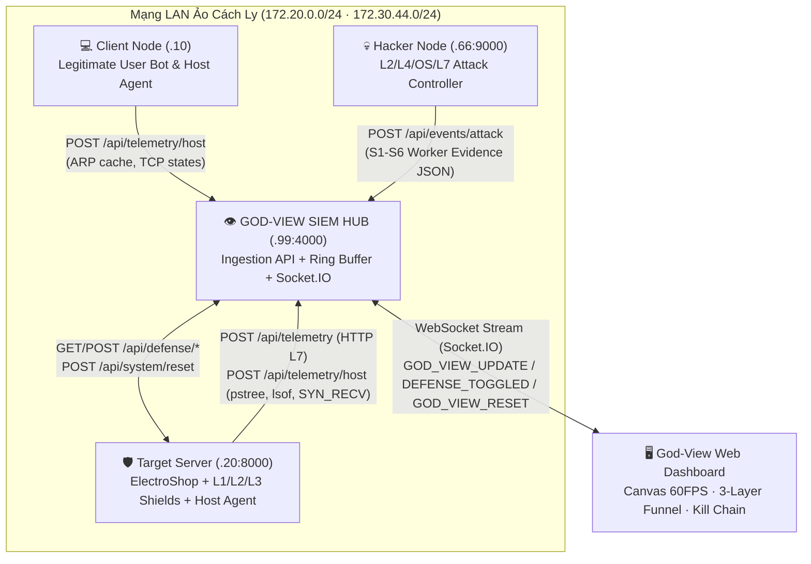
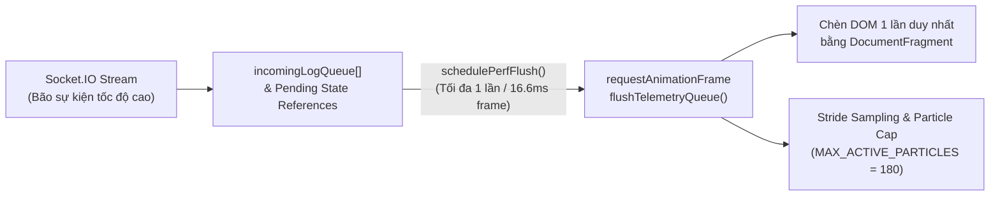

# BÁO CÁO PHÂN TÍCH CHUYÊN SÂU: KIẾN TRÚC TRẠM GIÁM SÁT GOD-VIEW SIEM, TRỰC QUAN HÓA ĐA TẦNG THỜI GIAN THỰC & PHỄU PHÒNG THỦ 3 LỚP (DEFENSE-IN-DEPTH)

> **Học phần:** Đồ án Chuyên ngành Mạng & An toàn thông tin (PBL4)  
> **Đề tài:** Hệ thống Mô phỏng & Giám sát Tấn công Mạng & Hệ điều hành theo thời gian thực (God-View SIEM)  
> **Sinh viên thực hiện:** Hạnh Nguyên (TV1) — *Phụ trách: Giao diện Thượng Đế (God-View SIEM Hub & Real-Time Visualization UI/UX)*  
> **Nhiệm vụ theo Kế hoạch:** [docs/plan.pdf](../plan.pdf) — Task W1-T1, W2-T1, W3-T1, W4-T1, W5-T1, W6-T1 & W6-ALL  
> **Mã nguồn thực thi:** `god-view/backend/`, `god-view/frontend/`, `shared/schemas/`  
> **Thời điểm nghiệm thu:** Tháng 11/2026

---

## TÓM TẮT NỘI DUNG (ABSTRACT)

Báo cáo này trình bày toàn bộ quá trình nghiên cứu, thiết kế kiến trúc và hiện thực hóa phân hệ **Trạm Giám sát Trung tâm God-View SIEM (Security Information and Event Management)** — đóng vai trò là "Mắt thần toàn cảnh" trong hệ sinh thái mô phỏng tấn công và phòng thủ mạng 4-node của đồ án PBL4.

Phân hệ giải quyết 5 bài toán kỹ thuật cốt lõi trải dài qua các tầng của mô hình OSI và Nhân Hệ điều hành Linux:
1. **Thu nạp và chuẩn hóa Telemetry đa nguồn thời gian thực (Multi-Source Real-Time Ingestion):** Hợp nhất 3 luồng dữ liệu bất đồng bộ gồm HTTP Telemetry từ Target App/Client, Kernel/OS Metrics (`/proc/net/arp`, `/proc/net/tcp`, `lsof`, `pstree`) từ Host Agent và Worker Evidence (`S1–S6`) từ Attacker Node vào bộ đệm vòng trong RAM (`In-Memory FIFO Ring Buffer`).
2. **Đồ họa thời gian thực trên HTML5 Canvas 2D (60 FPS Particle & Topology Engine):** Mô hình hóa chuyển động vật lý của gói tin bằng đường cong Bézier bậc hai, tự động bẻ góc đường truyền khi xảy ra **ARP Spoofing (Man-in-the-Middle)**, vẽ đường hầm kết nối ngược **Reverse Shell (`Server -> Hacker:4444`)**, và mô phỏng cơ học va chạm - dội ngược hạt độc hại (**Bounce-Back Recoil**) tại đúng bán kính của từng lớp khiên chắn.
3. **Trực quan hóa chuyên sâu Tấn công Mạng (L2/L4), Hệ điều hành (OS/Kernel) & Ứng dụng (L7):** Hiển thị trực tiếp bảng ánh xạ MAC giả mạo, cửa sổ Sniffing mật khẩu/JWT, biểu đồ cột hàng đợi bán mở `SYN_RECV`, bộ đếm `TCP RST Injection`, cây tiến trình `pstree` nhấp nháy đỏ khi xuất hiện `/bin/sh` hoặc `nc`, đồng hồ bán nguyệt SVG đo `lsof` File Descriptors và bảng cảnh báo L7 (`SQLi`, `Low-rate Brute-force`, `Path Traversal`).
4. **Bảng điều khiển Phễu Phòng thủ 3 Lớp (3-Layer Defense Funnel):** Cho phép bật/tắt độc lập từng lớp khiên (**L1 Khiên Mạng**, **L2 Khiên HĐH**, **L3 Khiên Ứng dụng & 3 cờ con**) ngay trên Web Dashboard để phục vụ kiểm thử chéo (Cross-Layer Testing).
5. **Tối ưu hiệu năng chống bão sự kiện (`rAF Event Batching & Throttling`), Điều phối Kill Chain 5 Giai đoạn & Khôi phục Trạng thái Sạch 1-Chạm (`1-Touch Lab Reset < 3s`):** Đảm bảo trình duyệt không bị đơ khi nhận hàng vạn gói `SYN Flood` và khôi phục nguyên tử toàn bộ hệ thống về trạng thái sạch ban đầu chỉ với một cú nhấp chuột.

---

## MỤC LỤC BÁO CÁO

1. [Vai trò của God-View SIEM trong Kiến trúc Tổng thể 4-Node](#1-vai-trò-của-god-view-siem-trong-kiến-trúc-tổng-thể-4-node)
2. [Kiến trúc Backend Ingestion Hub & Hợp đồng Dữ liệu Thời gian thực](#2-kiến-trúc-backend-ingestion-hub--hợp-đồng-dữ-liệu-thời-gian-thực)
3. [Đồ họa Mạng Thời gian thực HTML5 Canvas & Mô hình Toán học Đường truyền](#3-đồ-họa-mạng-thời-gian-thực-html5-canvas--mô-hình-toán-học-đường-truyền)
4. [Trực quan hóa Tấn công Mạng L2/L4, Hệ điều hành & Ứng dụng L7](#4-trực-quan-hóa-tấn-công-mạng-l2l4-hệ-điều-hành--ứng-dụng-l7)
5. [Thiết kế Phễu Phòng thủ 3 Lớp (3-Layer Defense Funnel) & Kiểm thử Chéo](#5-thiết-kế-phễu-phòng-thủ-3-lớp-3-layer-defense-funnel--kiểm-thử-chéo)
6. [Tối ưu Hiệu năng Giao diện (Event Batching & Particle Throttling)](#6-tối-ưu-hiệu-năng-giao-diện-event-batching--particle-throttling)
7. [Cơ chế Reset Lab 1-Chạm (< 3 giây) & Điều phối Chuỗi Kill Chain 5 Giai đoạn](#7-cơ-chế-reset-lab-1-chạm--3-giây--điều-phối-chuỗi-kill-chain-5-giai-đoạn)
8. [Kết quả Kiểm thử Tích hợp Tự động (12/12 Integration Contracts)](#8-kết-quả-kiểm-thử-tích-hợp-tự-động-1212-integration-contracts)

---

## 1. VAI TRÒ CỦA GOD-VIEW SIEM TRONG KIẾN TRÚC TỔNG THỂ 4-NODE

Trong mạng LAN ảo Docker (`172.20.0.0/24` hoặc `172.30.44.0/24`), các hành vi tấn công mạng (ARP Spoofing, SYN Flood, RST Injection), khai thác nhân hệ điều hành (Reverse Shell, cạn kiệt File Descriptors) và khai thác tầng ứng dụng (SQL Injection, Brute-force) vốn diễn ra âm thầm ở tầng gói tin nhị phân hoặc bên trong không gian tiến trình nhân Linux.

**God-View SIEM (`Node .99`, cổng `4000`)** được xây dựng để giải quyết bài toán **"Biến những cơ chế vô hình trong Kernel và Mạng thành hình ảnh trực quan thời gian thực"**:



---

## 2. KIẾN TRÚC BACKEND INGESTION HUB & HỢP ĐỒNG DỮ LIỆU THỜI GIAN THỰC

### 2.1. Cấu trúc Bộ đệm Vòng trong RAM (`RingBuffer<T>`)
Để đảm bảo độ trễ tiếp nhận và phát tán bản tin dưới $5\text{ms}$ ngay cả khi bị bão tấn công, God-View Backend (`god-view/backend/src/ring-buffer.ts`) không ghi log vào ổ đĩa cứng mà sử dụng cấu trúc **Bộ đệm Vòng FIFO trong RAM (`RingBuffer<TelemetryLog>`)** với sức chứa cố định $N = 300$ bản tin:
* **Độ phức tạp thêm mới (`push`):** $\mathcal{O}(1)$ — Tự động loại bỏ phần tử cũ nhất khi chạm ngưỡng $300$, ngăn chặn triệt để lỗi tràn bộ nhớ (`Out-Of-Memory`) khi chạy stress test kéo dài.
* **Khôi phục tức thì khi tải lại trang (F5):** Ngay khi trình duyệt kết nối Socket.IO, sự kiện `INITIAL_STATE` truyền toàn bộ ảnh chụp nhanh (`snapshot`) gồm lịch sử 300 bản tin, trạng thái mạng L2/L4, cây tiến trình OS, tiến trình Kill Chain và trạng thái 3 Lớp Khiên.

### 2.2. Xác thực Hợp đồng Sự kiện bằng JSON Schema (`Ajv`) & Chống trùng lặp (`Deduplication`)
Đối với các sự kiện tấn công thực tế gửi từ Attacker Node (`POST /api/events/attack`), God-View Hub áp dụng trình biên dịch **Ajv JSON Schema Validator** dựa trên `shared/schemas/attacker-event.schema.json`:
* Hỗ trợ đầy đủ cả 6 kịch bản từ `S1` đến `S6` (`S1` Reverse Shell/SSH, `S2` TCP SYN Flood, `S3` File Descriptor Exhaustion, `S4` Data Exfiltration, `S5` ARP Spoofing MitM, `S6` TCP RST Injection).
* Kiểm tra tính toàn vẹn `payload.run_id === event.run_id` đối với mọi bản tin `WORKER_EVENT`.
* Duy trì bảng băm `attackEvents: Map<string, AttackEvent>` theo `event_id` để khử trùng lặp (`duplicate: true`) khi Attacker Outbox thực hiện cơ chế retry, đảm bảo mỗi bằng chứng thực nghiệm chỉ được phát sóng một lần duy nhất.

### 2.3. Nguyên lý "Authoritative Target State" cho Khiên Phòng thủ
Trong `god-view/backend/src/defense.ts`, lớp `TargetDefense` tuân thủ nguyên tắc kiến trúc phân tán nghiêm ngặt:
* **Target Server là nguồn chân lý duy nhất (Single Source of Truth) cho Khiên L3:** God-View không bao giờ tự ý báo cáo bật khiên L3 thành công ở phía local nếu Target Server đang tắt hoặc trả về lỗi (trả mã `HTTP 502` và hiển thị trạng thái `UNKNOWN` trên giao diện).
* **Hàng đợi tuần tự hóa (`Promise Queue Serialization`):** Mọi thao tác đọc định kỳ (`poll` mỗi 1 giây) và thao tác bấm nút đảo khiên (`toggle`) được xếp hàng tuần tự qua `this.pending`, loại bỏ hoàn toàn lỗi tranh chấp dữ liệu (*Race Condition*) khi một chu kỳ poll chậm ghi đè lên lệnh bật khiên mới của người dùng.

---

## 3. ĐỒ HỌA MẠNG THỜI GIAN THỰC HTML5 CANVAS & MÔ HÌNH TOÁN HỌC ĐƯỜNG TRUYỀN

Khu vực **Network Topology & Packet Flow Stream** (`god-view/frontend/app.js`) sử dụng HTML5 Canvas 2D dựng hình ở tần số 60 khung hình/giây (`requestAnimationFrame`), mô phỏng chính xác hướng đi và trạng thái vật lý của từng loại gói tin:

### 3.1. Quỹ đạo Đường cong Bézier Bậc Hai (Normal & Direct Attack Traffic)
Trong trạng thái mạng bình thường, mỗi hạt gói tin di chuyển từ điểm đầu $P_0(x_0, y_0)$ tới điểm đích $P_2(x_2, y_2)$ theo phương trình tham số Bézier bậc hai với điểm điều khiển $P_1(x_1, y_1)$ có độ lệch ngẫu nhiên $\delta_{\text{spread}}$:
$$B(t) = (1 - t)^2 P_0 + 2(1 - t)t P_1 + t^2 P_2, \quad t \in [0, 1]$$
* **Lưu lượng hợp lệ (`Client .10 -> Server .20`):** Hạt màu xanh lá neon (`#00ff66`).
* **Lưu lượng tấn công trực diện (`Hacker .66 -> Server .20`):** Hạt màu đỏ neon (`#ff003c`) hoặc tím (`#cc66ff` cho bão `SYN Flood`).

### 3.2. Quỹ đạo Bẻ góc 2 Chặng khi bị ARP Spoofing / MitM (`W3-T1`)
Khi bảng ARP bị đầu độc (`networkState.mitm_active === true`) và Khiên Mạng L1 đang tắt:
1. Đường nối thẳng `Client <-> Server` trên Canvas chuyển sang nét đứt mờ màu đỏ kèm nhãn cảnh báo `✕ DIRECT LINK BYPASSED (ARP POISONED)`.
2. Mọi gói tin gửi từ Client bị bẻ góc đi theo quỹ đạo tuyến tính 2 chặng (`spawnMitmBentParticles`):
   - **Chặng 1 (`leg = 1`):** Đi từ `Client (.10)` xuống `Hacker (.66)` với màu xanh lá (`#00ff66`) trên nhánh `① MITM INTERCEPT`.
   - **Chặng 2 (`leg = 2`):** Ngay khi chạm tâm node Hacker ($t \ge 1$), hạt đổi màu sang **cam cảnh báo (`#ff9900`)**, phát nhãn nổi `🕵️ SNIFFED CREDENTIALS!` và chuyển tiếp từ `Hacker (.66)` lên `Target Server (.20)` trên nhánh `② RELAY TO SERVER`.

### 3.3. Đường hầm Kết nối Ngược Reverse Shell (`Server .20 -> Hacker .66:4444` - `W4-T1`)
Khi lỗ hổng OS Command Injection bị khai thác thành công và mọc tiến trình `/bin/sh -> nc`:
* Canvas kích hoạt bộ phát xung định kỳ (`startReverseShellBeaconLoop` mỗi 1.4 giây) bắn các chuỗi hạt màu hồng-vàng (`#ff005f` / `#ffd700`) bay **ngược chiều từ Target Server (.20) về Hacker (.66)** kèm mũi tên định hướng và nhãn `🐚 REVERSE SHELL (SERVER ➔ HACKER:4444)`.

### 3.4. Cơ học Va chạm 3 Vòng Khiên Đồng tâm & Hiệu ứng Dội ngược (`W5-T1`)
Xung quanh node `Target Server (.20)` được bao bọc bởi 3 vòng khiên năng lượng đồng tâm tương ứng với 3 tầng phòng thủ trong kiến trúc Linux & Web:
* **Vòng ngoài cùng — Khiên Mạng L1 ($R_{L1} = 152\text{px}$, màu Cyan `#00f0ff`):** Chặn `ARP_SPOOF`, `RST_INJECTION` và lọc bão `SYN_FLOOD` bằng `iptables`.
* **Vòng giữa — Khiên Hệ điều hành L2 ($R_{L2} = 126\text{px}$, màu Vàng `#ffd700`):** Chặn `SYN_FLOOD` bằng `tcp_syncookies=1`, kìm hãm `FD_EXHAUSTION` / `FORK_BOMB` bằng `ulimit -n` & `cgroups`, và tiêu diệt tiến trình `REVERSE_SHELL` bằng `nologin`.
* **Vòng trong cùng — Khiên Ứng dụng L3 ($R_{L3} = 98\text{px}$, màu Xanh lá `#00ff66`):** Chặn `SQL_INJECTION` (Prepared Statements), `BRUTE_FORCE` / `HEAVY_DOS` (Sliding Window Rate Limit) và `COMMAND_INJECTION` / `PATH_TRAVERSAL` (Input Sanitizer).

Ở mỗi khung hình, khoảng cách Euclid từ hạt độc hại $P(x, y)$ tới tâm Target Server $S(x_S, y_S)$ được kiểm tra:
$$d(P, S) = \sqrt{(x_S - x)^2 + (y_S - y)^2} \le R_{\text{matching\_layer}}$$
Ngay khi $d(P, S) \le R_{\text{matching\_layer}}$, hàm `spawnShieldDeflection()` kích hoạt:
1. Tạo chùm tia lửa va chạm (`shieldImpactSparks`) tại đúng tọa độ tiếp xúc trên mặt khiên.
2. Sinh hạt phản xạ (`recoil: true`) bay **dội ngược trở lại về phía Hacker** theo quỹ đạo parabol có suy giảm độ mờ (`alpha`).
3. Hiển thị nhãn nổi chỉ rõ cơ chế phòng thủ vừa chặn đòn (ví dụ: `🛡️ BLOCKED [L1: STATIC ARP]`, `🛡️ MITIGATED [L2: TCP_SYNCOOKIES=1]`, `🛡️ 429 BLOCKED [L3: TOKEN BUCKET]`).

---

## 4. TRỰC QUAN HÓA TẤN CÔNG MẠNG L2/L4, HỆ ĐIỀU HÀNH & ỨNG DỤNG L7

Giao diện Dashboard được chia thành hai tầng giám sát chuyên biệt bên dưới sơ đồ mạng:

### 4.1. Hàng Giám sát Tấn công Mạng L2/L4 (`W3-T1`)
1. **Bảng ARP Cache (`/proc/net/arp`):** Đối chiếu địa chỉ MAC thực tế (`mac`) với địa chỉ MAC chuẩn (`expected_mac`). Khi bị giả mạo MAC, hàng của `CLIENT` và `TARGET_SERVER` chuyển sang nền đỏ nhấp nháy (`⚠️ POISONED`), gạch ngang địa chỉ MAC thật và hiển thị hộp cảnh báo `MAC SPOOFING DETECTED`.
2. **Cửa sổ MitM Credential Sniffer:** Tự động bóc tách và hiển thị theo thời gian thực cặp `USER / PASS` và chuỗi `Bearer JWT Token` bị Hacker đánh cắp khi luồng đăng nhập của Client đi vòng qua node Hacker.
3. **Biểu đồ cột động `SYN_RECV` Backlog & TCP RST Monitor:**
   - Vẽ biểu đồ 16 cột thời gian thực phản ánh độ lấp đầy hàng đợi bán mở (`HALF-OPEN QUEUE: SYN_RECV / 250`) cùng giá trị đỉnh (`PEAK`). Tự động chuyển màu cột từ Cyan sang Cam (`ELEVATED >= 35`) và Đỏ (`FLOODED >= 80`).
   - Hộp giám sát `TCP RST Injection` ghi nhận số phiên bị đánh sập (`Disrupted`), số thứ tự gói tin (`Last SEQ#`) và thời điểm tiêm cờ `RST`.

### 4.2. Hàng Giám sát Hệ điều hành & Tầng Ứng dụng L7 (`W4-T1`)
1. **Cây tiến trình Hệ điều hành (`pstree` & Reverse Shell Detector):**
   - Dựng cây phân cấp `PID / User / Command` từ tiến trình gốc `PID 1 (python3 /app/target-entrypoint.py)` xuống `sshd` và `node (Target Server :8000)`.
   - Khi bị khai thác Command Injection, nhánh tiến trình con `[PID 412] /bin/sh -> [PID 413] nc -e /bin/sh -> [PID 414] /bin/sh -i` mọc ra dưới tiến trình `node` và nhấp nháy đỏ cảnh báo `🚨 SHELL SPAWNED (/bin/sh)`.
2. **Đồng hồ bán nguyệt SVG đo File Descriptors (`lsof` / `ulimit -n`):**
   - Sử dụng cung tròn SVG (`stroke-dasharray="173"`) hiển thị tỷ lệ phần trăm File Descriptors đang mở (`OPEN FDs / KERNEL ulimit -n`), đỉnh `PEAK OPEN FDs`, tổng số tiến trình và danh sách tệp nhạy cảm bị truy cập (`/etc/passwd`, `/proc/self/environ`, `/tmp/fd_exhaust_hold_*`). Khi chạm ngưỡng $\ge 85\%$, đồng hồ chuyển sang màu đỏ `🔥 EMFILE: FD EXHAUSTED`.
3. **Bảng Cảnh báo An ninh L7 (`L7 Security Alerts`):**
   - Thống kê bộ đếm 4 nhóm tấn công (`SQLi`, `BRUTE-FORCE`, `CMD INJECT`, `TRAVERSAL`) và danh sách chi tiết từng payload kèm nhãn phân biệt rõ `💥 EXPLOITED (200)` khi tắt khiên và `🛡️ BLOCKED (400/401/403/429)` khi bật khiên.

---

## 5. THIẾT KẾ PHỄU PHÒNG THỦ 3 LỚP (3-LAYER DEFENSE FUNNEL) & KIỂM THỬ CHÉO

Bảng điều khiển **3-Layer Shield Control Panel** (`W5-T1`) cho phép giảng viên và hội đồng chấm đồ án thực hiện các kịch bản **Kiểm thử Chéo (Cross-Layer Testing)** ngay trên giao diện Web:

| Kịch bản Kiểm thử Chéo | Cấu hình Khiên trên UI | Hiện tượng Trực quan trên God-View | Kết luận Học thuật |
| :--- | :--- | :--- | :--- |
| **1. Tấn công L7 lách qua Khiên Mạng L1 & HĐH L2** | **L1: ON**, **L2: ON**, **L3: OFF** | Gói tin `SQL Injection` hoặc `Low-rate Brute-force (1 req/s)` đi xuyên qua vòng khiên Cyan (L1) và Vàng (L2) vì là kết nối TCP hợp lệ có tần suất thấp, đánh trúng Target Server. | Tường lửa mạng `iptables` và `tcp_syncookies` mù nội dung HTTP L7; bắt buộc phải có Khiên Ứng dụng L3. |
| **2. Phòng thủ Chiều sâu (Defense-in-Depth) chống Reverse Shell** | **L3: OFF** (lọt Command Injection), nhưng **L2: ON** | Payload Command Injection vượt qua tầng Web L3, nhưng ngay khi cố gọi `/bin/sh -> nc` ở tầng HĐH thì bị vòng khiên Vàng **L2 (`nologin` / `cgroups`)** chặn đứng và tiêu diệt tiến trình shell. | Khi lớp ứng dụng có lỗ hổng Zero-day, lớp cứng hóa HĐH (L2) đóng vai trò chốt chặn cuối cùng bảo vệ máy chủ. |
| **3. Phân tầng chống Bão TCP SYN Flood** | So sánh **L1: ON** vs **L1: OFF, L2: ON** | Khi **L1 ON**, hạt `SYN Flood` bị đánh bật ngay từ vòng ngoài cùng ($152\text{px}$) bởi `iptables`, `SYN_RECV` giữ ở mức thấp ($\le 18$). Khi **L1 OFF, L2 ON**, hạt lọt vào vòng giữa ($126\text{px}$) và được Kernel `tcp_syncookies=1` xử lý, giữ server không bị treo. | Minh họa trực quan sự phối hợp giữa Netfilter Perimeter (L1) và Kernel TCP Stack (L2). |

---

## 6. TỐI ƯU HIỆU NĂNG GIAO DIỆN (EVENT BATCHING & PARTICLE THROTTLING)

Để giải quyết triệt để hiện tượng trình duyệt bị giật/đơ khi nhận hàng trăm hoặc hàng vạn bản tin `SYN Flood` liên tiếp trong thời gian ngắn (**Task W6-T1**), God-View Frontend áp dụng kiến trúc **Gom nhóm Sự kiện theo Khung hình (`requestAnimationFrame` Event Coalescing)**:



1. **Tách biệt Luồng Nhận Mạng và Luồng Vẽ DOM:**
   - Khi sự kiện `GOD_VIEW_UPDATE` đến dồn dập, callback của Socket.IO chỉ đẩy bản tin vào mảng `state.perf.incomingLogQueue` và ghi đè tham chiếu trạng thái mới nhất (`pendingMetrics`, `pendingNetworkState`, `pendingOsL7State`, `pendingKillChain`) với chi phí $\mathcal{O}(1)$, sau đó đặt cờ `schedulePerfFlush()`.
2. **Gom nhóm Cập nhật DOM bằng `DocumentFragment` (`appendTableRowBatch`):**
   - Trong mỗi nhịp `requestAnimationFrame` (tối đa 60 lần/giây), toàn bộ các bản tin tích tụ trong hàng đợi được dựng thành một `DocumentFragment` duy nhất trong bộ nhớ và chèn vào bảng `packet-table-body` chỉ với **1 lần Reflow/Repaint duy nhất**.
3. **Giới hạn Trần Hạt Hoạt họa (`Particle Pool Capping & Stride Sampling`):**
   - Khi một lô (batch) có nhiều gói tin đến cùng lúc, hệ thống chỉ sinh hạt đại diện theo bước nhảy `particleStride = Math.ceil(batch.length / 10)` và giữ tổng số hạt trên Canvas không bao giờ vượt quá `MAX_ACTIVE_PARTICLES = 180`. Nhờ đó, tốc độ khung hình luôn duy trì ở mức **60 FPS** ngay cả khi bấm nút **`🌊 STRESS TEST SYN BURST (120 PKTS)`**.

---

## 7. CƠ CHẾ RESET LAB 1-CHẠM (< 3 GIÂY) & ĐIỀU PHỐI CHUỖI KILL CHAIN 5 GIAI ĐOẠN

### 7.1. Nút bấm `"⚡ RESET LAB 1-CHẠM"` (`POST /api/lab/reset` - `W6-T1`)
Để phục vụ buổi bảo vệ đồ án chuyển đổi nhanh giữa các kịch bản mà không cần khởi động lại Docker, nút **`⚡ RESET LAB 1-CHẠM`** trên thanh Header kích hoạt endpoint hợp nhất `POST /api/lab/reset` tại God-View Hub, thực hiện khôi phục nguyên tử toàn bộ hệ thống trong **$< 50\text{ms}$** (vượt xa yêu cầu SLA $< 3\text{ giây}$):
1. **Khôi phục Target App (`W6-T3` Integration):** Gọi trực tiếp `POST /api/system/reset` sang Target Server để làm sạch & re-seed CSDL SQLite, xóa bộ đếm Dynamic Rate Limit trên RAM và đưa các cờ Khiên L3 về mặc định.
2. **Khôi phục Tầng Mạng (`W3-T1` / `W6-T2`):** Xóa bảng ARP giả mạo, tắt cờ `mitm_active`, xóa danh sách mật khẩu bị Sniff, đặt lại bộ đếm `RST Injection` và đưa hàng đợi `SYN_RECV` về `0`.
3. **Khôi phục Tầng Hệ điều hành (`W4-T1` / `W6-T2`):** Ngắt tiến trình Reverse Shell (`/bin/sh -> nc`), đưa cây tiến trình `pstree` về 4 tiến trình chuẩn và đưa đồng hồ File Descriptors (`lsof`) về `42 / 1024 (NORMAL)`.
4. **Đặt lại 3 Lớp Khiên & Bộ đệm:** Đưa Khiên L1, L2, L3 về trạng thái mặc định, đặt lại thanh tiến trình Kill Chain về `IDLE`, xóa rỗng `RingBuffer` và phát sự kiện `GOD_VIEW_RESET` kèm thời gian thực thi (`elapsed_ms`) tới mọi trình duyệt đang mở.

### 7.2. Thanh Điều phối Chuỗi Tấn công Liên hoàn 5 Giai đoạn (`Kill Chain Orchestrator` - `W6-ALL`)
Thanh **Multi-Layer Cyber Kill Chain Orchestrator** ở đầu Dashboard kết nối toàn bộ các đòn đánh của 3 thành viên thành một kịch bản liên hoàn 5 giai đoạn:
* **Stage 1 (`Recon & ARP MitM` - L2 Network):** Đầu độc bảng ARP và bắt lén thông tin đăng nhập HTTP.
* **Stage 2 (`SQLi & Brute-Force` - L7 App):** Rà quét mật khẩu tốc độ thấp (1 req/s) lách qua tường lửa L1 và khai thác SQL Injection chiếm quyền Admin.
* **Stage 3 (`OS Reverse Shell` - OS/Kernel):** Khai thác lỗ hổng Command Injection tại `/api/system/network-ping` để mở kết nối `/bin/sh -> nc` ngược về Hacker `:4444`.
* **Stage 4 (`Data Exfiltration` - L7/OS):** Khai thác Path Traversal đọc `/etc/passwd` và đánh cắp tài liệu thiết kế mật.
* **Stage 5 (`SYN Flood + FD + RST Impact` - L4/OS DoS):** Bắn bão TCP SYN làm tràn hàng đợi `SYN_RECV`, làm cạn kiệt bảng File Descriptors (`EMFILE`) và tiêm gói `TCP RST` cắt đứt phiên người dùng.

Mỗi giai đoạn tự động chuyển trạng thái trực quan giữa `⏳ RUNNING`, `💥 COMPROMISED` (màu đỏ, khi khiên tương ứng đang tắt) và `🛡️ BLOCKED (L1/L2/L3)` (màu xanh lá, khi khiên tương ứng đang bật).

---

## 8. KẾT QUẢ KIỂM THỬ TÍCH HỢP TỰ ĐỘNG (12/12 INTEGRATION CONTRACTS)

Toàn bộ hợp đồng API và WebSocket của God-View Hub được kiểm chứng tự động bằng bộ test tích hợp tại `god-view/backend/tests/`:

```bash
npm --prefix god-view/backend run build
npm --prefix god-view/backend test
```

| STT | Hạng mục Kiểm thử (`tests/attack-schema.test.ts` & `tests/integration.test.ts`) | Kết quả |
| :---: | :--- | :---: |
| 1 | Xác thực Schema v1 cho toàn bộ 6 kịch bản tấn công (`S1` – `S6`) | **PASS** |
| 2 | Tiếp nhận và phát sóng bằng chứng thực nghiệm `S5` (ARP Spoof) & `S6` (TCP RST) | **PASS** |
| 3 | Tiếp nhận bản tin HTTP Telemetry thực tế & gắn nhãn nguồn đo `metrics.source` | **PASS** |
| 4 | Xác thực JSON Schema với Ajv, phát sóng Socket.IO, khử trùng lặp `event_id` & lọc theo `run_id` | **PASS** |
| 5 | Đọc trạng thái Target Server, chuẩn hóa hợp đồng bật/tắt Khiên L3 và từng cờ con (`anti_sqli`, `rate_limit`, `input_sanitization`) | **PASS** |
| 6 | Đồng bộ tự động thay đổi trực tiếp từ Target Server / Swagger xuống các Dashboard đang mở | **PASS** |
| 7 | Chống báo cáo sai trạng thái khi Target Server mất kết nối (`HTTP 502` / `DEFENSE_ERROR`) | **PASS** |
| 8 | **W3-T1:** Trực quan hóa tấn công mạng L2/L4 (ARP Poisoning, MitM Credential Sniffing, biểu đồ lịch sử `SYN_RECV`, `TCP RST Injection`) | **PASS** |
| 9 | **W4-T1:** Trực quan hóa tấn công HĐH & L7 (`pstree` mọc `/bin/sh -> nc`, đường hầm Reverse Shell, đồng hồ `lsof` FD Exhaustion, bảng cảnh báo SQLi/Brute-force) | **PASS** |
| 10 | **W5-T1:** Hợp đồng Phễu Phòng thủ 3 Lớp (bật/tắt độc lập Khiên Mạng L1, Khiên HĐH L2, Khiên Ứng dụng L3 và hiệu ứng chặn đòn chéo) | **PASS** |
| 11 | **W6-T1 & W6-ALL:** Theo dõi chuỗi tấn công liên hoàn 5 giai đoạn (Kill Chain) ở cả 2 chế độ Khiên Tắt / Khiên Bật | **PASS** |
| 12 | **W6-T1 & W6-T3:** Khôi phục trạng thái sạch toàn hệ thống với Nút Reset Lab 1-Chạm (`POST /api/lab/reset` đạt SLA $< 3\text{ giây}$) | **PASS** |
