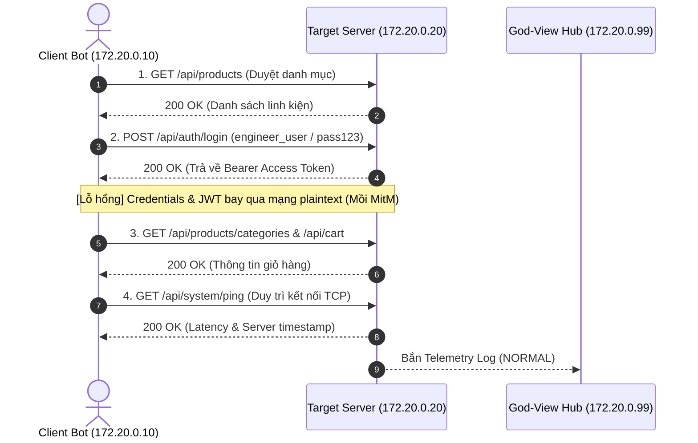

# Script Giả Lập Người Dùng (Client Bot Traffic Generator - Task W3-T3)

> **Người phụ trách:** Hoàng Trung (TV3) — *Target App & Tấn công Ứng dụng L7*  
> **Tài liệu tham chiếu:** [docs/plan.pdf](../../docs/plan.pdf) (Task W3-T3), [docs/api/target-server/target-server-api.md](../../docs/api/target-server/target-server-api.md) (Mục 4)

---

## 1. Mục đích & Vai trò trong Hệ sinh thái PBL4

Trong hệ thống phòng thủ & tấn công thực nghiệm, **Client Bot** đóng vai trò là lưu lượng người dùng thật (Legitimate User Traffic) hoạt động định kỳ:
1. **Làm "con mồi" cho Kịch bản MitM Sniffing (S5 / W3-T2):**
   - Định kỳ gửi yêu cầu đăng nhập `POST /api/auth/login` với tài khoản `engineer_user` / `pass123` qua giao thức HTTP không mã hóa (Port 8000).
   - Kẻ tấn công (Minh Trí - Scapy ARP Spoofing) khi đứng giữa sẽ bắt được gói tin chứa mật khẩu và Bearer JWT Token của người dùng.
2. **Làm mục tiêu cho Kịch bản Ngắt Kết Nối TCP RST Injection (W3-T2):**
   - Định kỳ gửi `GET /api/system/ping?echo=integration-client` để duy trì kết nối TCP liên tục giữa Client và Target Server.
   - Kẻ tấn công tiêm gói tin `TCP RST` giả mạo sequence number để ngắt kết nối giữa chừng, khiến Client Bot báo lỗi mất kết nối.
3. **Cung cấp dữ liệu Telemetry cho God-View Dashboard:**
   - Tạo luồng request bình thường (`is_suspicious: false`) để God-View hiển thị các hạt gói tin xanh di chuyển giữa Client và Server trước khi bị tấn công.

---

## 2. Các hành vi trong một chu kỳ (Chu kỳ 3–5 giây)



---

## 3. Hướng dẫn sử dụng

### Cách 1: Chạy bằng Python (Khuyến nghị cho Linux VM/Lab)
```bash
# Cấp quyền thực thi nếu cần
chmod +x target-app/agents/client_bot.py

# Chạy bot với cấu hình mặc định (kết nối localhost:8000)
python3 target-app/agents/client_bot.py

# Tùy biến địa chỉ máy chủ và chu kỳ
python3 target-app/agents/client_bot.py --target-url http://172.20.0.20:8000 --interval 3.0

# Chạy thử nghiệm 1 chu kỳ duy nhất
python3 target-app/agents/client_bot.py --once
```

### Cách 2: Chạy bằng Node.js
```bash
chmod +x target-app/agents/client-bot.js
node target-app/agents/client-bot.js
```

### Cách 3: Chạy trong môi trường Docker Compose
Client Bot đã được tích hợp sẵn trong service `client` của file `compose.integration.yaml`:
```bash
./scripts/integration-lab.sh up
```

---

## 4. Các biến môi trường hỗ trợ

| Tên biến | Mặc định | Ý nghĩa |
| :--- | :--- | :--- |
| `TARGET_APP_URL` | `http://localhost:8000` | Địa chỉ gốc của Target Server |
| `CLIENT_INTERVAL_SEC` | `3.5` | Khoảng thời gian nghỉ giữa các chu kỳ (giây) |
| `CLIENT_USERNAME` | `engineer_user` | Tài khoản đăng nhập định kỳ |
| `CLIENT_PASSWORD` | `pass123` | Mật khẩu tài khoản |
| `PROBE_FILE_PATH` | `/tmp/client-probe.json` | Đường dẫn file ghi log probe cho Docker Healthcheck |
